# Slice Master 6000
### version 1.0.0
### Donald Beaudry (K1DBO)

------------------------------------------

#### Control the slices of your FlexRadio with Slice Master 6000.


# Features
#### Configures and launches third party programs for each slice
+ CW Skimmer, GRITTY, DM780, WSJT-X, JTDX, MSHV, JS8Call, flDigi, MMTTY

#### Launches Skim Master for each DAX IQ channel
+ CW Skimmer Server, RTTY Skimmer Server, and FT8, FT4 and WSPR skimmers

#### Collects spots and shows them on the SmartSDR panafalls
+ spots from the programs it launches, Skim Master, N1MM Logger+, telnet
  clusters, CC User, SpotCollector, HRD Logbook, AC Log, Logger32, DX Summit and POTA

#### Sends all collected spots on one telnet connection

#### Shows spectrum maps, spot lists and bookmarks, and puts them on the panafalls

#### Lets you set which spots show, and how
+ views and datasets: your own layers, rules, colors, scores and click actions

#### Sends decodes to programs that listen for WSJT-X
+ GridTracker, JTAlert, or a logger

#### Colors spots with N1MM Logger+ multipliers, or with the "needed" status from
+ SpotCollector, HRD Logbook, AC Log, Logger32

#### Gives each slice its own HRD and CAT over TCP listener

#### Keeps the slices and panafalls in step
+ frequency, center, zoom, scale

#### Has an audio mixer
+ solo, mute, AGC, sidetone, monitor, level presets, and pan presets
+ audio that follows the N1MM Logger+ stereo key

------------------------------------------

#
# Introduction

Slice Master 6000 configures and launches third party programs for
the slices of your radio.  It can launch a program for each slice that
is active.  The panafall of that slice must have the DAX channel or the
DAX IQ channel that the program needs.

Slice Master and the programs it launches stay connected.  When you
click a signal in CW Skimmer, the slice tunes to that signal.  When you
tune the slice, CW Skimmer follows the slice.

You can also use Slice Master alone.  It keeps slices and panafalls in
step, and it has an audio mixer.  Its HRD listener gives HRD programs
control of each slice.

Slice Master collects spots from many sources, and it shows the spots on
its own spectrum maps and lists.  It also puts the spots on the
SmartSDR panafalls, and it sends them to your logger on its telnet port.


# Getting Started

The current version of this guide is at

```
    https://github.com/K1DBO/slice-master-6000
```

The latest release is at

```
    https://github.com/K1DBO/slice-master-6000/releases
```

Download the zip file of the release and open it.  Run the
`slice-master-<version>-setup.exe` in the zip file, and do the steps
it shows.  The setup installs Slice Master 6000 and Skim Master, and it
adds Slice Master 6000 to the Start menu.  It also opens the Windows
firewall for Slice Master, so that Slice Master can connect to your
radio and to your programs.

After the files are in, the setup shows two pages: **Programs**, the
programs that Slice Master launches, and **Skimmers**, the programs that
Skim Master runs.  Each program has a field with the path where the setup
found it.  A field is empty when the program is not found, and you can
leave it empty.  To change a path, click **Browse** beside it, and select
the program's .exe file.  The file dialog shows only files of that name,
so that you can use its search box to find the program.  Click **Next**
to keep the paths.  You can run the setup again at any time to change
them.

On the last page of the setup, **Open the README in your web browser** is
selected, and this guide opens when you click **Finish**.  To read the guide
at a later time, open Slice Master 6000 in the Start menu and click
**README**.

Each time it installs, the setup keeps a copy of your settings file,
`config.ini`, in this folder:

```
C:\Users\<your user name>\AppData\Local\K1DBO\slice-master-data\config-backups
```

The name of the copy tells the date and the version that the setup
installed.  Uninstall does not remove this folder.

Before you use a third party program with Slice Master, start it one
time without Slice Master.  Enter your station information in that
program, for example your callsign and your grid square.  Slice Master
then puts this information into each instance of the program that it
launches.


# Configuration

The Slice Master window has these tabs:

- **Launch**: the programs that Slice Master launches, for each slice
  and each DAX IQ channel.
- **Sync**: the settings that make one slice follow another slice.
- **Mix**: the audio mixer.
- **View**: the spectrum maps, the spot lists, the bookmarks, and the
  Library, where you change views and datasets.
- **...**, the last tab: the settings.

The line at the bottom of the window shows Slice Master's status.
Put the pointer on the status line to see the last 15 messages.

Slice Master is light or dark as Windows is set.  To change it, open the
Windows Settings, go to **Personalization** and **Colors**, and select the
app mode, **Light** or **Dark**.

## Launch

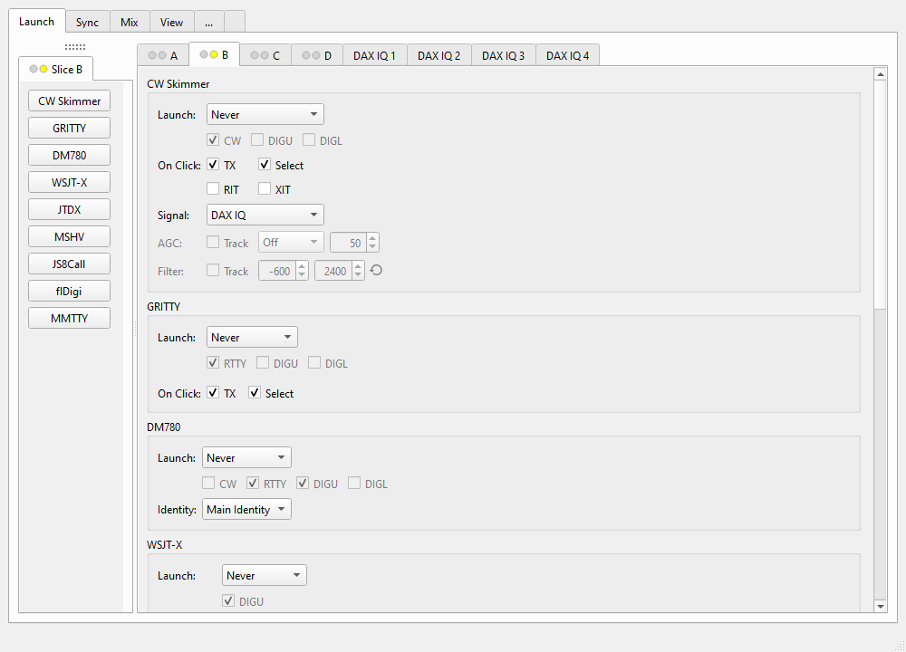

The Launch tab has one tab for each slice of your radio: **A**, **B**,
**C** and more.  Each slice tab has two dots.  The first dot is red
when the slice is the TX slice, and the second dot is yellow when the
slice is the active slice.  Click a slice tab to make that slice the
active slice.

After the slice tabs, the Launch tab has one tab for each DAX IQ
channel: **DAX IQ 1** to **DAX IQ 4**.  These tabs show Skim Master.

Each slice tab has a section for each program that Slice Master found
on your computer.  If a program is not installed, its section does not
show.  If a program is in a folder that Slice Master does not know, see
Missing features.

Each section has a **Launch** box with three choices:

- **Never**: Slice Master does not launch the program for this slice.
- **When active**: Slice Master launches the program when the slice is
  active.
- **By mode**: Slice Master launches the program when the slice is
  active and in one of the modes that you select.

Slice Master sets the rig type and the audio devices of each program
that it launches.  You set the slice in SmartSDR: set the mode, and
select the DAX channel.  If something is not correct, Slice Master
shows a message on its status line.

The quick launch is at the left of the Launch tab, and it has one button
for each program.  Click a button to set the Launch box of that program
to **When active**.  The program then starts.  Click the button again
to set the Launch box to **Never**.  The text of a button is green
while its program runs.  When a DAX IQ tab is open, the quick launch
shows the skimmer buttons of that DAX IQ channel.  Drag the grip at the
top of the quick launch to put it in a window of its own.

### CW Skimmer

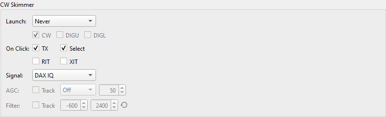

Slice Master configures and launches CW Skimmer for you.  You change
only your own preferences in CW Skimmer.

- **Launch**: when to launch CW Skimmer.  For **By mode**, select **CW**,
  **DIGU** or **DIGL**.
- **On Click**: what a click on a signal in CW Skimmer does.  Select
  **TX** to make this slice the TX slice.  Select **Select** to make this
  slice the active slice.
- **RIT**: select it to change only the receive frequency when you click
  a signal near the slice frequency.
- **XIT**: select it to change only the transmit frequency when you click
  a signal near the slice frequency.  You can select RIT or XIT, not both.
- **Signal**: the signal that CW Skimmer uses.  **DAX IQ** is the DAX IQ
  channel of the panafall.  **DAX Audio** is the DAX audio channel of
  the slice; CW Skimmer then shows 3 kHz of the band.
- **AGC**: for DAX Audio only.  Select **Track** to set the AGC of the
  slice while CW Skimmer runs.  Select the AGC mode and the AGC level.
- **Filter**: for DAX Audio only.  Select **Track** to set the filter of
  the slice while CW Skimmer runs.  Set the low and the high edge in Hz.
  Click the reset button to set the filter to 3000 Hz, with the CW
  pitch in it.

For CW Skimmer to launch with DAX IQ, the panafall of the slice must
have a DAX IQ channel.

### GRITTY

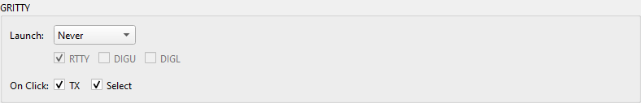

- **Launch**: when to launch GRITTY.  For **By mode**, select **RTTY**,
  **DIGU** or **DIGL**.
- **On Click**: what a click in the GRITTY window does.  Select **TX** to
  make this slice the TX slice.  Select **Select** to make this slice the
  active slice.

### DM780

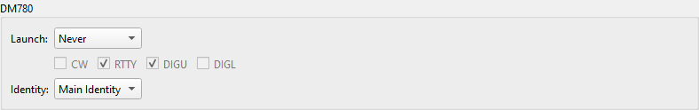

- **Launch**: when to launch DM780.  For **By mode**, select the modes.
- **Identity**: the DM780 identity to use.  An identity keeps the
  screen layout, the radio layout and DM780's settings.  Use one
  identity for each type of operation.

### WSJT-X

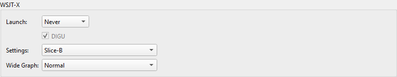

- **Launch**: when to launch WSJT-X.  For **By mode**, select **DIGU**.
- **Settings**: the settings folder of this instance of WSJT-X.  Each
  instance of WSJT-X that runs at the same time must have its own settings
  folder.  Slice Master gives each slice a settings folder.  To make a
  new settings folder, select **&lt;new&gt;**, type a name, and push Enter.
- **Wide Graph**: how WSJT-X's Wide Graph window starts:
  **Normal**, **Minimized**, or **Last**, as it was when WSJT-X stopped.

A settings folder of WSJT-X is not the same as a WSJT-X
"Configuration".  A Configuration is a set of settings in a settings
folder.

In the WSJT-X settings, the Rig is "FlexRadio 6xxx" and the Network
Server is Slice Master.  These settings are correct.  Do not change
them.

For WSJT-X to launch, the slice must have a DAX audio channel.

### JTDX

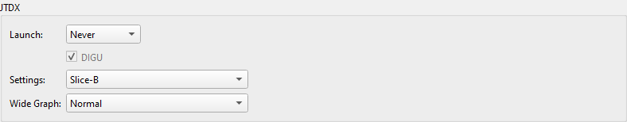

JTDX has the same settings as WSJT-X: **Launch**, **Settings** and
**Wide Graph**.  Each instance of JTDX that runs at the same time must have
its own settings folder.

### MSHV

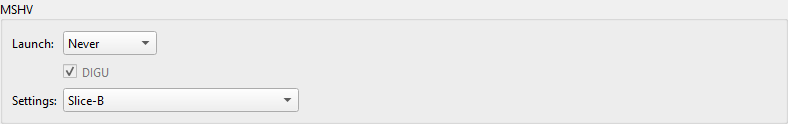

MSHV has the **Launch** and **Settings** settings of WSJT-X.  Each instance
of MSHV that runs at the same time must have its own settings.

### JS8Call

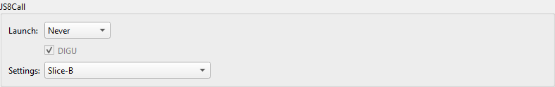

JS8Call has the **Launch** and **Settings** settings of WSJT-X.  Each
instance of JS8Call that runs at the same time must have its own settings
folder.

### flDigi

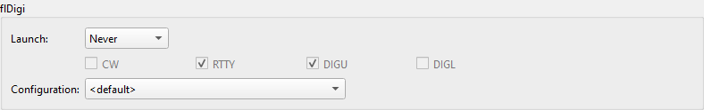

- **Launch**: when to launch flDigi.  For **By mode**, select the modes.
- **Configuration**: the flDigi configuration to use.  Instances of
  flDigi can use the same configuration.  You can use the default
  configuration, or make one for each mode.  To make a configuration,
  select **&lt;new&gt;**, type a name, and push Enter.

### MMTTY

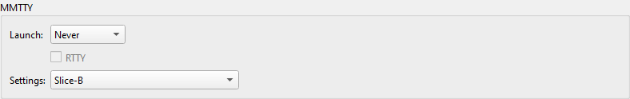

- **Launch**: when to launch MMTTY.  For **By mode**, select **RTTY**.
- **Settings**: the settings of this instance of MMTTY.  Each instance of
  MMTTY must have its own settings.  Slice Master gives each slice its own
  settings.  To make new settings, select **&lt;new&gt;**, type a name, and
  push Enter.

MMTTY shows only when SmartSDR CAT has COM ports.

### Skim Master

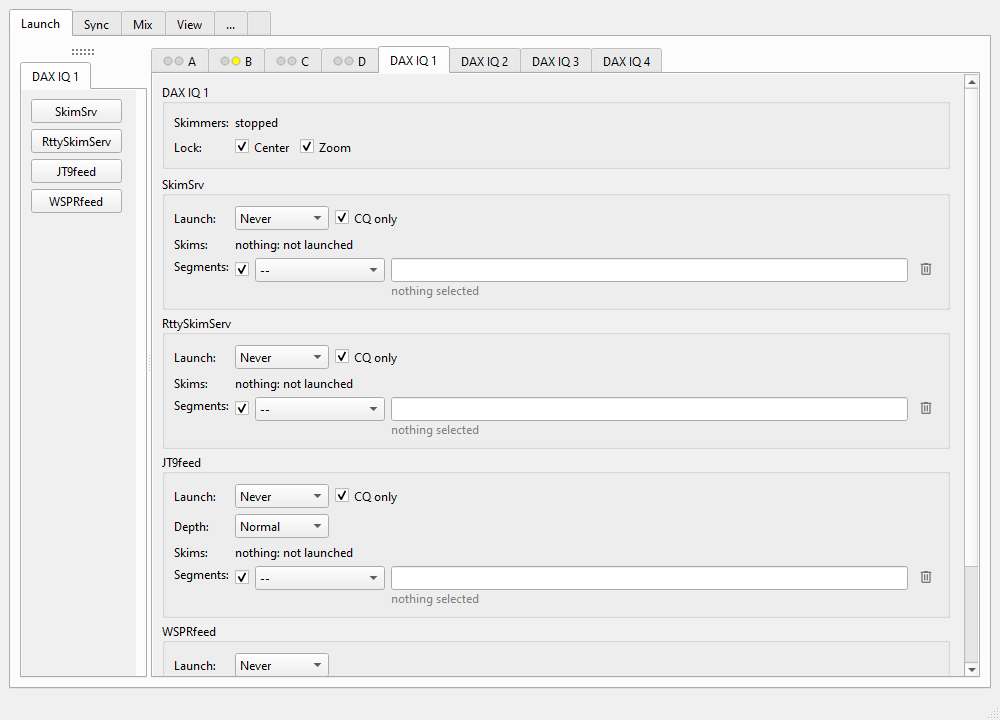

Skim Master skims a DAX IQ channel.  It runs CW Skimmer Server, RTTY
Skimmer Server, and its own FT8, FT4 and WSPR skimmers, and it sends
their spots to Slice Master.  Each **DAX IQ** tab has the settings for
one DAX IQ channel.

The guide [Skim Master](doc/SkimMaster.md) tells you what you need, and
how to skim a band step by step.

The top section shows the channel:

- **Skimmers**: what the skimmers skim now, or why they stop.
- **Lock**: select **Center** to hold the panafall where the skimmers
  skim.  Select **Zoom** to zoom the panafall to what the skimmers skim.

Then each skimmer has a section: **SkimSrv** (CW Skimmer Server),
**RttySkimServ** (RTTY Skimmer Server), **JT9feed** (FT8, FT4 and
other WSJT-X modes) and **WSPRfeed** (WSPR).

- **Launch**: **Never**, or **When active**: when a panafall has this
  DAX IQ channel.
- **CQ only**: select it to send only the spots of stations that call CQ.
- **Depth**: for JT9feed and WSPRfeed.  **Deep** finds more stations,
  and uses more CPU.
- **Skims**: what the skimmer skims now.
- **Segments**: the parts of the band to skim, one row each.  In each
  row, select a view, and type band and plan words, or frequency pairs
  like 7.000-7.040.  Under the row, Slice Master shows what the row
  finds.  Select the check box of a row to use it.  Click the trash can to
  remove a row.  Type in the blank row to add a row.

## Sync

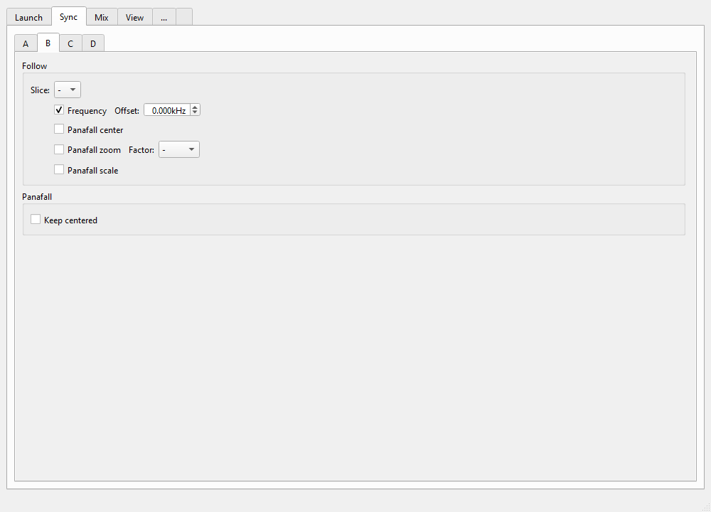

The Sync tab has one tab for each slice.  On the tab of a slice, you
set the slice that it follows.

In the **Follow** section:

- **Slice**: the slice to follow.  Select **-** to follow no slice.
- **Frequency**: select it to tune this slice when the followed slice
  tunes.  **Offset** is the kHz to add to the frequency of the followed
  slice.
- **Panafall center**: select it to keep the panafall centered as the
  panafall of the followed slice.
- **Panafall zoom**: select it to zoom the panafall as the panafall of the
  followed slice.  **Factor** is how much more or less of the band this
  panafall shows.
- **Panafall scale**: select it to set the scale of the panafall as the
  panafall of the followed slice.

In the **Panafall** section, select **Keep centered** to keep the slice
in the center of its panafall.

## Mix

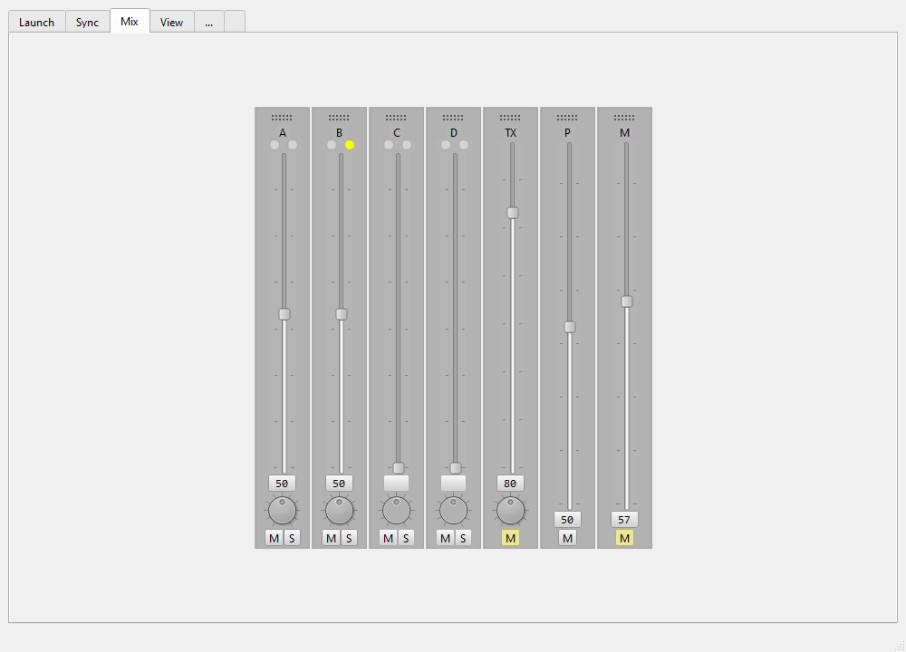

The Mix tab has one fader for each slice, **A** to **H**.  It also has
the faders **S** (sidetone), **M** (monitor), **P** (headphones) and
**L** (master volume).  The meter of **S** shows the forward power: it moves
while you send CW.

Each slice fader has:

- the slice letter, with two lights: the TX slice light and the active
  slice light.
- the AGC mode button.
- the level meter.
- the gain slider, and the AGC sliders.
- the pan knob.  Click it to set the pan to center or to your preset.
  Push Shift and click to keep the pan as your preset.
- the gain button.  Click it to set the pan and gain to your presets.
  Push Shift and click to keep them as your presets.
- **M**: mute.
- **S**: solo.  When Solo level is set in the Mixer settings, solo
  lowers the other slices to that level.

Drag a fader by its grip to put it in a window of its own.  Click the
place it left to bring it back.

The Mixer section of the settings sets which faders show.

## View

The View tab has the displays of your spots: **Map**, **List**,
**Radio**, **Overlay** and **Bookmarks**.  The last tab, **...**, is the
Library, where you change views and datasets.  Click **+** at the right
to add a map or a list.

Each display has the same header:

- the **SM6K** chip.  Drag it to move the display to a window of its
  own.
- the view box: the view that the display shows.  By default, Map and
  List show **All**.
- the target box: the slice that a click on a spot tunes.  **@** is the
  active slice, **TX** is the TX slice, or select a slice letter.

The spectrum maps have a guide of their own: [Spectrum Maps](doc/SpectrumMaps.md).  It gives all the details of each display.

### Map

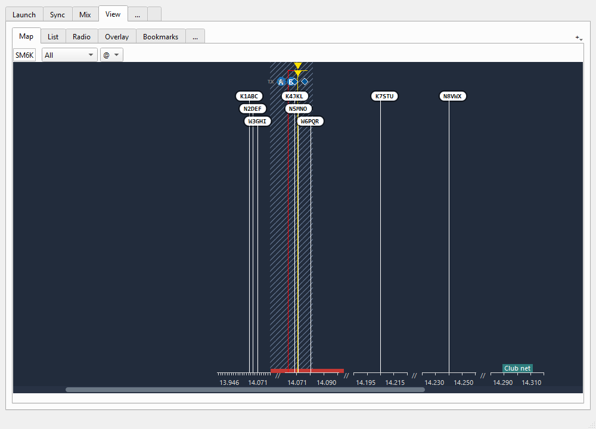

A map shows the band as a strip, with the frequency scale at the
bottom.  Where spots are near each other, the scale opens up, so that
you can read each callsign.  Where there are no spots, the scale closes
up, and `//` shows the gap.

Each spot stands on a stick that points to its frequency.  The best
spots are at the top.  A spot from a program that Slice Master launched
has round corners, but a spot from outside has square corners.

Each slice shows as SmartSDR shows it: a line at its frequency, yellow
for the active slice and red for the other slices, with a bar as wide as
its filter.  The disc with the slice letter is beside the line.

- Put the pointer on a spot to see its note.
- Click a spot to tune the slice of the target box to it.
- Double-click a spot to do what its dataset sets: tune, or tune and
  send the spot to the programs on the telnet port.
- Right-click a spot to select a slice for one click, to log a QSO with
  the station, or to remove the spot.
- Click the disc of a slice to type a spot at its frequency.  Type the
  callsign and a note, and push Enter.
- Turn the mouse wheel, or push Page Up, Page Down, Home or End, to
  move along the band.

### List

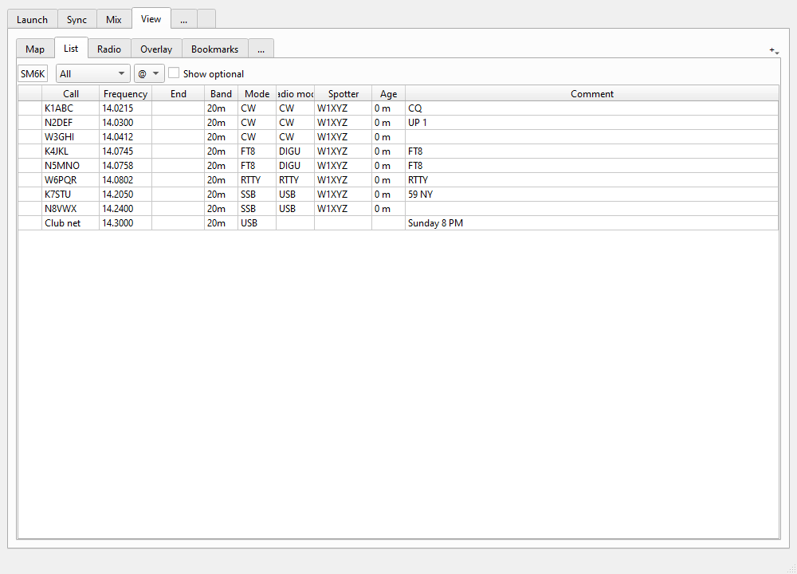

A list is a table of the spots of its view, one row each, the best spots
first.  By default, the columns are Call, Frequency, End, Band, Mode, Radio
mode, Spotter, Age and Comment.  Each callsign has the colors that its
dataset gives it.  Radio memories, bookmarks and band plan segments are
rows too.

- Select **Show optional** to also list the spots that the view shows
  optional, on tinted rows.
- Double-click a row to tune the slice of the target box to it.
- Drag a column header to move the column.  Drag its edge to change its
  width.
- Right-click the header to select the columns.

Rows that are the same in all the columns that show become one row.
The first column shows how many spots the row has.

### Radio

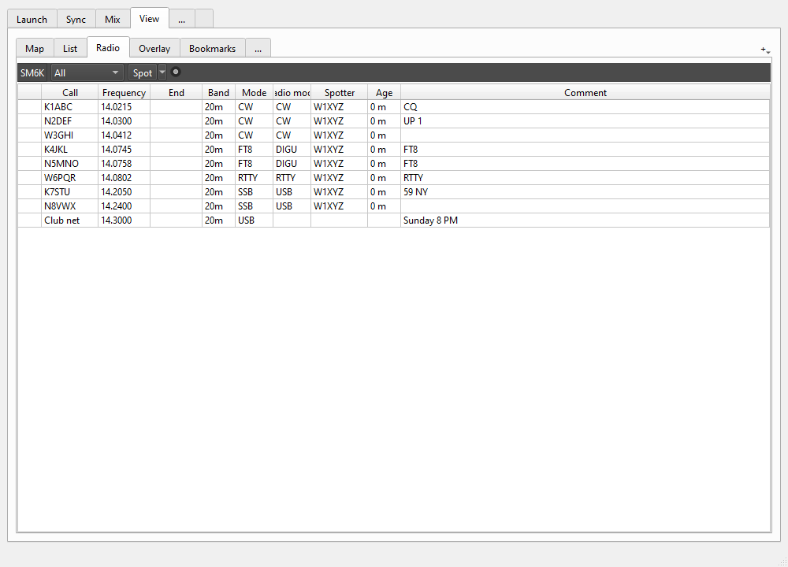

The Radio tab sets the view that goes to the radio's panafalls, and
it lists the spots that the radio gets.  Select **--** to send no spots
to the radio.

- The view box: the radio's view.
- The target box: the slice that a click on a spot on a SmartSDR
  panafall tunes.
- **Spot**: type a spot, a bookmark or a memory at the slice.  Click
  the arrow to select which one.
- The round button: click it to take Slice Master's spots off the
  panafalls.  Click it again to put them back.

Drag the **SM6K** chip to SmartSDR's title bar.  A small chooser
then stays on the title bar, with the same controls.  Click its **X** to
put it away.

### Overlay

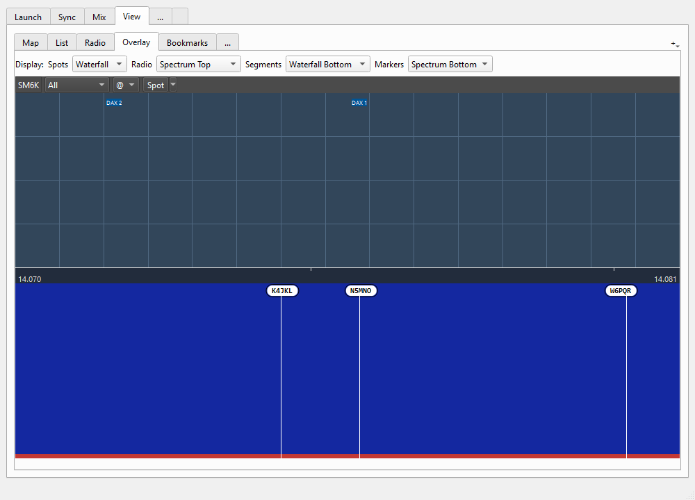

An overlay is a map on a SmartSDR panafall.  The Overlay tab shows how
an overlay of its view looks, on a sample panafall.  To make an
overlay, drag the **SM6K** chip onto a SmartSDR panafall.  Do this for
each panafall that you want.  Each overlay has its own view box, its
target box, **Spot**, a button that hides the spots, and an **X** that
closes it.

The **Display** row sets where each overlay shows its items:

- **Spots**: over the **Waterfall** or over the **Spectrum**.
- **Radio**: where the DAX IQ channels show.
- **Segments**: where the band plan segments show.
- **Markers**: where the memories and the bookmarks show.

Each of the last three is **Spectrum Top**, **Spectrum Bottom**,
**Waterfall Top** or **Waterfall Bottom**.  Select **--** to show
nothing.

An overlay keeps clear of SmartSDR's controls.  To let it cover
them, clear **Overlays keep clear of SmartSDR's controls** in the
Spectrum Map settings.

### Bookmarks

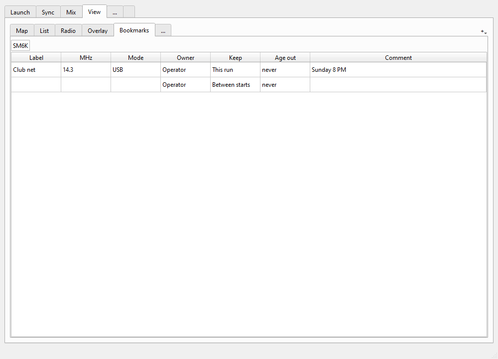

A bookmark is a frequency that you keep, with a label: a net, a calling
frequency, a beacon.  It is not a spot.  The Bookmarks tab lists the
bookmarks, one row each: Label, MHz, Mode, Owner, Keep, Age out and
Comment.

- To add a bookmark, type a label and a frequency in the last row.
- To change a cell, double-click it, or select it and type.  MHz takes
  14.230 or 14230.
- **Keep**: **This run**, or **Between starts**.
- **Age out**: the minutes until the bookmark goes.  Empty is never.
- To delete bookmarks, select their rows and push Delete.

The owner of a bookmark is the program that set it, or **Operator** for
your own.  N1MM Logger+ sets bookmarks for its CQ frequencies.

### Views

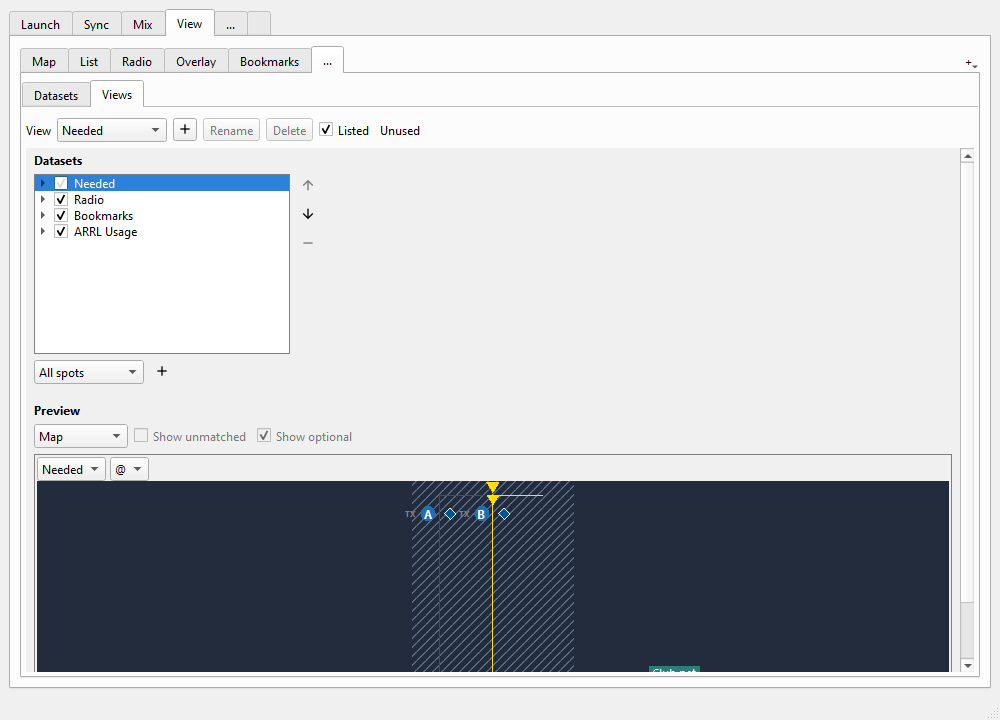

A view is the spots that a display shows, and it is made of datasets.
To change a view, click the **...** tab, then click **Views**.  You can
also click the gear of a display to open its view here.

- **View**: select the view to change.
- **+**: add a copy of this view.
- **Rename** and **Delete**: rename or delete this view.
- **Listed**: select it to show this view in the view boxes of the
  displays.
- **Used by**: the displays that show this view.

The **Datasets** list has the datasets of the view.  Select a dataset to
use it.  Clear it to keep it in its place, not used.  Under each
dataset are its layers.  Select a layer to show it in the view.

- Click the up and down arrows to move the selected dataset.
- Click **-** to remove the selected dataset from the view.
- Select a dataset in the box, and click **+** to add it at the top of
  the view.

The **Preview** shows the view.  Select **Map**, **List**, or **Map and
list**.  Select **Show unmatched** to list the spots that the view does
not let in.  Select **Show optional** to show the optional spots too.

### Datasets

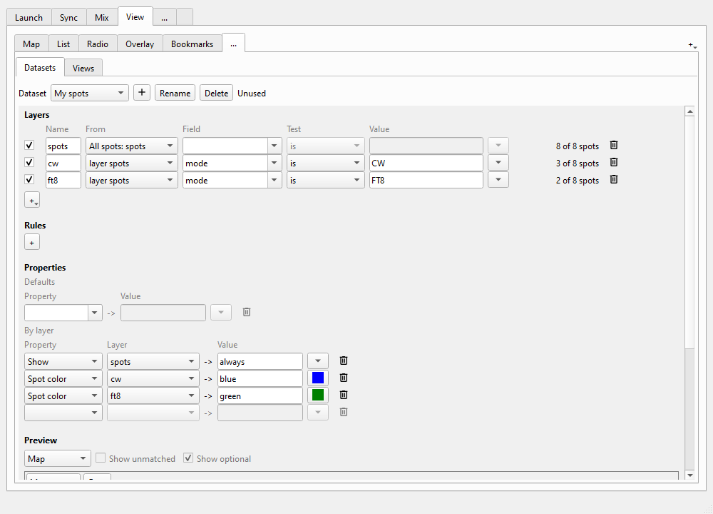

A dataset puts spots into layers, and gives the spots their properties:
color, place, and more.  To change a dataset, click the **...** tab,
then click **Datasets**.

- **Dataset**: select the dataset to change.  The datasets that come
  with Slice Master are gray: you cannot change them.  Click **+** to
  make a copy, and change the copy.
- **Rename** and **Delete**: rename or delete this dataset.

The example above is a dataset of your own, "My spots".  Its layer
**spots** has all the spots.  Its layer **cw** has the CW spots of the
layer spots, and its layer **ft8** has the FT8 spots.  Its properties
show all the spots, make the CW spots blue, and make the FT8 spots
green.

**Layers** has one row for each layer:

- the check box: select it to use the layer.
- **Name**: the name of the layer.  Slice Master gives a new layer a
  number: 1, 2, 3.  Type over the number to give it a name of your own,
  for example **pota**.  The rules and the properties use this name.
- **From**: where the layer gets its spots: a layer of a dataset, or a
  layer of this dataset.  Click the box to select from a tree.
- **Field**: the field of the spot to test, for example **mode**.
- **Test**: **is**, **is not**, **matches**, or **matches regex**.
- **Value**: the value to test for, for example **CW**.  Click the
  button at the right to select from the values that the spots have now.
- the count: how many spots the layer has now.
- the trash can: delete the layer.

Click **+** under the layers to add a layer, or a list of items.

**Rules** has one row for each rule.  A rule makes a set of spots from
the layers and the rules above it, by their names, for example
`pota also in cw`.  Click **+** under the rules, type the rule, and push
Enter.  The guide [Spectrum Maps](doc/SpectrumMaps.md) tells you how to
write a rule.

**Properties** gives the spots their properties.  **Defaults** sets a
property for all the spots.  **By layer** sets a property for the spots
of one layer or rule.  Each row has a property, a layer, and a value.
Click the button at the right of a value to select a value, for
example a color.  Type in the blank row to add a property.

- **Show**: **always**, **optional** or **never**.  Always: the display
  shows the spots, and a map opens up to hold them.  Optional: the
  display shows them where it has space.  Never: the display does not
  show them.  A dataset shows nothing until a Show property shows it.
- **Score**: a number.  Spots with a higher score go higher on a map,
  and first in a list.  The scores of all the layers of a spot add up.
- **Rank**: the value that a program gives a spot, and it puts in order
  the spots that have the same score.  In a dataset of your own, use
  Score.
- **Place**: **top**, **bottom** or **own**.  It puts the bars of a band
  plan, or the row of a DAX IQ channel, at the top or at the bottom of
  a map.
- **Spot color**: the color of the text of the spot.
- **Spot background**: the color behind the text of the spot.
- **Click**: what a click and a double-click on a spot do, for example
  **Tune only** or **Tune and announce**.  Tune and announce also sends
  the spot to the programs on the telnet port.
- **Max age**: the minutes that the dataset keeps a spot after its last
  report.  After that time, the dataset does not show the spot.

When two layers give a spot the same property, the row of the lower
layer applies.  Only Score adds up.

The **Preview** shows the dataset, as on the Views page.

You can also write a dataset as a file.  The guide [Dataset Files](doc/DatasetFiles.md) tells you how.

## Settings

The last tab of the window, **...**, has the settings.  Each section shows only its name
and a short status line.  Click the line to open the section, and click
it again to close it.  Slice Master keeps open the sections
that you leave open.

### Radio

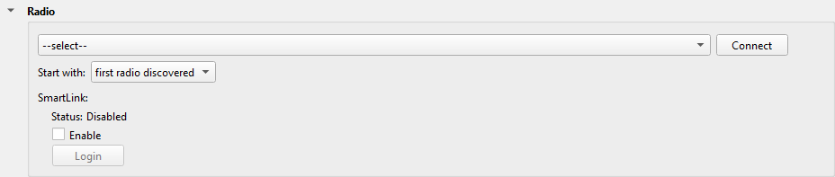

- Select your radio in the box, and click **Connect**.
- **Start with**: what Slice Master does when it starts: stay
  **radio disconnected**, connect to the **first radio discovered**, or
  connect to the **last radio connected**.
- **SmartLink**: select **Enable** to find your radio through SmartLink.
  Click **Login** and type your SmartLink email and password.  Click the
  eye at the end of the password field to see the password, and again to
  hide it.
  When the login is good, the status changes to "Connected as" and the
  callsign and name of your SmartLink account.

### Operator

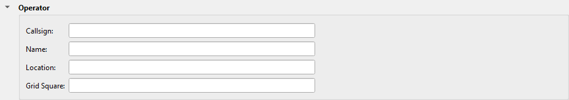

Type your **Callsign**, **Name**, **Location** and **Grid Square**.
Slice Master gives them to the programs that it launches.  The spot
sources need your callsign.

### Spot Sources

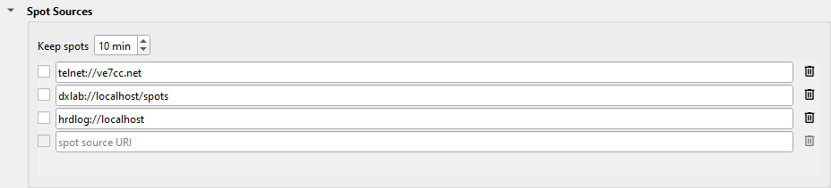

**Keep spots** is how many minutes Slice Master keeps a spot after its
last report.  A dataset can keep its spots longer; see [Spectrum Maps](doc/SpectrumMaps.md).

Each row is one spot source:

- the check box: select it to use the source.
- the URI of the source.
- the trash can: remove the source.

Type a URI in the blank row to add a source.  You can have ten sources.

The URIs:

- `telnet://[user:password@]server[:port][?command]`: a telnet cluster.
- `dxlab://server:port`: [DXLab SpotCollector](doc/DXLab.md).
- `dxldb://localhost/spots`: the SpotCollector database.  SpotCollector
  must run on the same computer.
- `hrdlog://server:port`: [HRD Logbook](doc/HRDLogbook.md).
- `aclog://server:port`: [N3FJP AC Log](doc/ACLog.md).
- `dxsmt://www.dxsummit.fi`: DX Summit.
- `pota://api.pota.app`: Parks on the Air.

The programs that Slice Master launches send their spots without a
source row.  The guide [Spot Sources](doc/SpotSources.md) tells you
the details of each URI.

### Spectrum Map

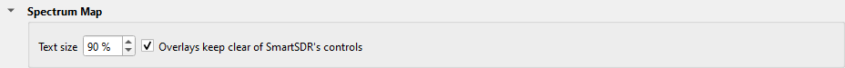

- **Text size**: the size of the text on the maps and the overlays, in
  percent.
- **Overlays keep clear of SmartSDR's controls**: select it to keep the
  overlays off the controls of the SmartSDR panafalls.

### Telnet Aggregation Server


Slice Master sends all the spots that it collects on one telnet port.
Connect your logger to this port.

- **Telnet port**: the port of the server.
- **Enable aggregation server**: select it to start the server.

The guide [Telnet Aggregation Server](doc/TelnetServer.md) tells you which
spots a logger gets, and the commands that it can send.

### CW Skimmer

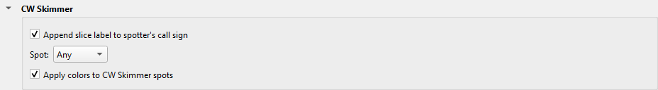

- **Append slice label to spotter's call sign**: select it to add the
  slice letter to the callsign of the spotter of each CW Skimmer spot.
- **Spot**: which CW Skimmer spots to send: **None**, **Any**, **CQ or
  DE**, or **CQ only**.
- **Apply colors to CW Skimmer spots**: select it to give CW Skimmer the
  colors of your datasets.

### Skim Master

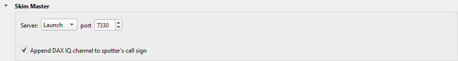

- **Server**: **Launch** to start Skim Master on this computer, at the
  **port** that you set.  **Connect** to use a Skim Master that runs on
  another computer: type its HOST:PORT.
- **Append DAX IQ channel to spotter's call sign**: select it to add the
  DAX IQ channel to the callsign of the spotter of each spot.

You set the skimmers of each DAX IQ channel on the Launch tab.  The guide
[Skim Master](doc/SkimMaster.md) tells you how to set up Skim Master.

### GRITTY

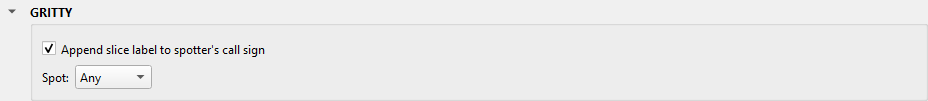

- **Append slice label to spotter's call sign**: as for CW Skimmer.
- **Spot**: which GRITTY spots to send.

### WSJT-X, JTDX, MSHV, JS8Call

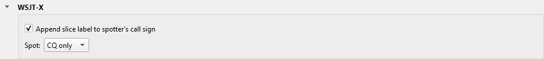

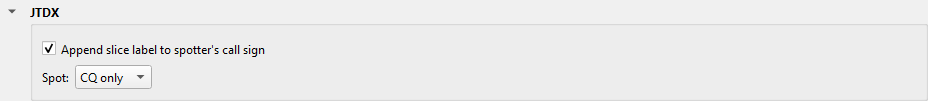

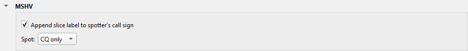

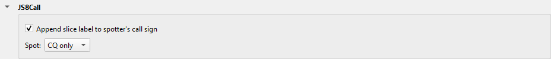

Each of these programs has the same two settings:

- **Append slice label to spotter's call sign**: as for CW Skimmer.
- **Spot**: which spots of the program to send.

### N1MM Logger+

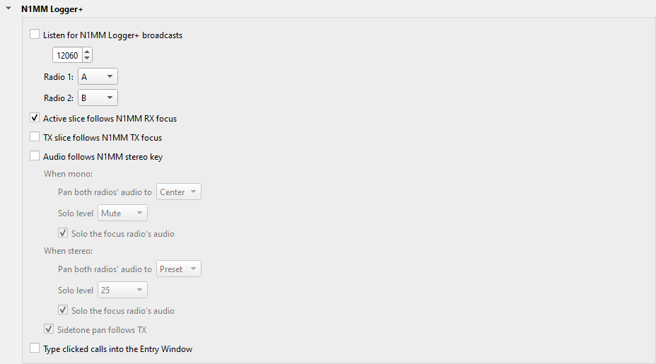

- **Listen for N1MM Logger+ broadcasts**: select it, and set the UDP port
  that N1MM Logger+ broadcasts to.
- **Radio 1** and **Radio 2**: the slice for each N1MM Logger+ radio:
  a slice letter, **TX** for the TX slice, or **None**.
- **Active slice follows N1MM RX focus**: select it to make the slice of
  the N1MM focus radio the active slice.
- **TX slice follows N1MM TX focus**: select it to make the slice of the
  N1MM TX radio the TX slice.
- **Audio follows N1MM stereo key**: select it to set the audio when you
  push the N1MM stereo key.
- **When mono** and **When stereo**: the audio for each state.  **Pan
  both radios' audio to** is **Center** or each radio's **Preset**.  **Solo
  level** is the level of the other slices.  Select **Solo the focus
  radio's audio** to solo it.  When stereo, select **Sidetone pan follows
  TX** to pan the sidetone with the TX slice.

### TCP CAT Listeners and HRD Listeners

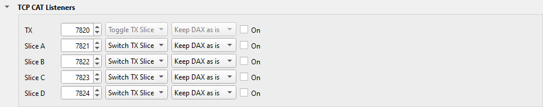

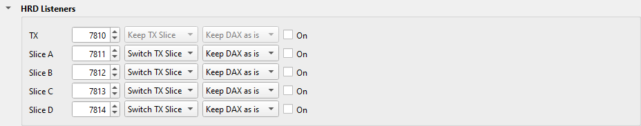

A listener lets a program control one slice, or the TX slice, on a TCP
port.  Programs that use CAT, for example Hamlib programs, connect to a
CAT listener.  HRD programs connect to an HRD listener.  The rows show
when a radio is connected.  Each row has:

- the slice, or **TX**.
- the TCP port that the program connects to.
- the TX choice: **Keep TX Slice**, **Switch TX Slice** or **Toggle TX
  Slice**: select this slice for TX when transmit is requested.
- the DAX choice: **Keep DAX as is**, **DAX Off**, **DAX On**, **Toggle
  DAX Off** or **Toggle DAX On**: set DAX TX audio when transmit is
  requested.
- **On**: select it to start the listener.

Each logger has a guide that tells you how to connect it to Slice Master:
[HRD Logbook](doc/HRDLogbook.md), [Log4OM](doc/Log4OM.md),
[Logger32](doc/Logger32.md), [N3FJP AC Log](doc/ACLog.md) and
[DXLab](doc/DXLab.md).

### Mixer

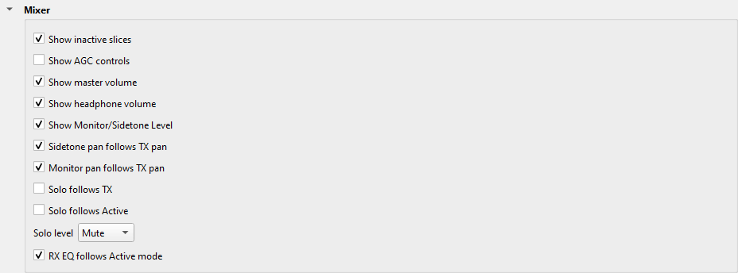

Select the items that you want:

- **Show inactive slices**, **Show AGC controls**, **Show master
  volume**, **Show headphone volume** and **Show Monitor/Sidetone
  Level**: the faders and controls that the Mix tab shows.
- **Sidetone pan follows TX pan** and **Monitor pan follows TX pan**.
- **Solo follows TX** and **Solo follows Active**: solo the TX slice or
  the active slice.
- **RX EQ follows Active mode**.
- **Solo level**: the level of the other slices when you solo a slice:
  **Mute**, **15**, **25**, **35**, or **Custom**.  If a slice solos
  when you change the Solo level, the solo changes to the new level.

### Status Broadcast

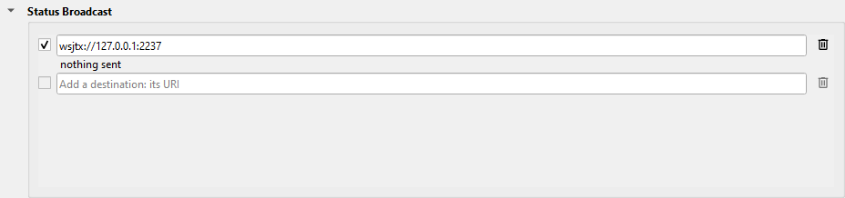

Slice Master sends the status of your radio to amplifiers, tuners, and
other programs, and sends to loggers the QSOs that you log from a spot.
Each row is one destination:

- the check box: select it to send to the destination.
- the URI of the destination.
- the trash can: remove the destination.
- under the URI: what the destination said last.

Type a URI in the blank row to add a destination.

A URI has the form `<type>://<host>:<port>?<conditions>`.  The type sets
the program that gets the messages.  The conditions select the slice that
the messages are about, for example `tx_ant=ANT2` for the slice that
transmits on ANT2.

```
kpa500://      the Elecraft KPA500 amplifier, through KPA500 Remote
kat500://      the Elecraft KAT500 tuner, through KAT500 Remote
hfauto://      the HF-Auto tuner, through the HF-Auto App
radioinfo://   RadioInfo packets, as N1MM Logger+ sends them, for loggers
meter://       the radio's meters, to a program of your own
wsjtx://       FT8 and other decodes, to programs that listen for WSJT-X
wsjtx-qso://   a QSO that you log from a spot, as WSJT-X sends it
adif-qso://    a QSO that you log from a spot, as ADIF text
```

The guide [Status Broadcast](doc/broadcast.md) tells you how to set up
each type.

### COM Ports

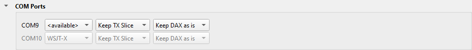

Some programs control the radio only through a COM port.  Slice Master
gives these programs COM ports from SmartSDR CAT.  You can also give a
port to a program that Slice Master does not launch, for example a
logger.  The port then follows the slice that you set.

Make the ports in SmartSDR CAT before you start Slice Master:

1. In SmartSDR CAT, add a port for each slice of your radio.  Add one
   more port for each logger that uses a port.
2. Give each port a name that starts with **SM6K-**, for example
   **SM6K-01**.
3. Set the port type to **Serial**.
4. Close SmartSDR CAT.
5. Start Slice Master, and then start SmartSDR CAT again if you use other
   SmartSDR CAT ports.

Slice Master must start before SmartSDR CAT.  If SmartSDR CAT starts
first, Slice Master cannot use the SM6K- ports.  You do not need to set
the other settings of these ports in SmartSDR CAT.

This section shows only when SmartSDR CAT has SM6K- ports.  Each row is
one port:

- the port: the COM port that the program opens.
- the slice of the port: **TX Slice**, **ACTIVE Slice**, or a slice
  letter.  **&lt;available&gt;** is a port that no program uses.  A port
  that a program uses is gray, and shows the name of that program.
- the TX choice and the DAX choice, as for the listeners.

The guide [COM Ports](doc/ComPorts.md) tells you how to give a port
to a logger.


# Start Up Options

You can give options when you start Slice Master from a command window
or a shortcut.  Usually you do not need them.  You give an option one
time: Slice Master keeps it, except the log options.

```
  --log-level LOGGER=LEVEL [LOGGER=LEVEL ...]
         more logging

  --log-preset PRESET
         a logging preset from the config file

  --window-width WIDTH
         width of the main window, in pixels

  --window-height HEIGHT
         height of the main window, in pixels

  --window-x X
         x position of the main window

  --window-y Y
         y position of the main window

  --window-minimized BOOL
         start with the main window minimized

  --color-scheme {light,dark,system}
         light, dark, or system (as Windows is set)

  --bandmap-persistence MINUTES
         remove a spot MINUTES after its last report

  --bandmap-stick-color COLOR
         the COLOR of the stick of all spots

  --fix-truncated-win10-audio-device-names BOOL
         fix truncated audio device names on Windows 10

  --skimmer-launch-delay DELAY
  --gritty-launch-delay DELAY
  --wsjtx-launch-delay DELAY
  --jtdx-launch-delay DELAY
  --mshv-launch-delay DELAY
  --js8call-launch-delay DELAY
  --dm780-launch-delay DELAY
  --fldigi-launch-delay DELAY
  --mmtty-launch-delay DELAY
         seconds to wait between two launches of the program

  --skimmer-connect-delay DELAY
         seconds to wait before Slice Master connects to CW Skimmer

  --wsjtx-udp-server SERVER:PORT
  --jtdx-udp-server SERVER:PORT
  --mshv-udp-server SERVER:PORT
  --js8call-udp-server SERVER:PORT
         the UDP server address and port for the program

  --radio-filter FILTER
         text that selects one radio when there are many

  --station STATION
         the name of the Multi-Flex station to bind to
```

# Trouble Shooting

## Programs that fail to start

- **CW Skimmer shows an "access violation" window.**  On the tab of the
  slice, select **Never** in **Launch**.  Then select **By mode** or
  **When active** again.
- **CW Skimmer does not start.**  Make sure that the slice is open in
  SmartSDR.  With **By mode**, make sure that the slice is in a mode
  that you selected.  With DAX IQ, make sure that the panafall of the
  slice has a DAX IQ channel.  Look at the status line at the bottom of
  the window: it shows most start-up problems.
- **A program does not start after Slice Master stopped unexpectedly.**
  The programs that Slice Master launched can still run.  Close them
  from their menus, or from Task Manager.  Then start Slice Master
  again.
- **CW Skimmer starts with the wrong Signal I/O Device.**  Close the DAX
  Control Panel and start it again.  If that does not help, restart the
  computer.

## &lt;no connection&gt;

If Slice Master cannot connect to your radio, look at the Windows
firewall.  The setup lets Slice Master through the Windows firewall.  If
you changed the firewall, or if you use a different firewall program,
let Slice Master through it.

## Programs missing from the Launch tab

Slice Master looks for each program in the program's default folder.  If you installed a program in a different folder, Slice
Master does not find it, and the Launch tab does not show it.

Run the setup of Slice Master again.  On its **Programs** or **Skimmers**
page, click **Browse** beside the program, and select its .exe file.

# Support

Bug reports are welcome.  Send them to the email address on Slice
Master's splash screen.

Before you send a report:

1. Make sure that you have the latest version of Slice Master.  It is
   here:

   ```
   https://github.com/K1DBO/slice-master-6000/releases
   ```

2. Restart your computer and your radio, and make sure that the problem
   is still there.

A zip file of Slice Master's log files helps to find the problem fast:

1. In File Explorer, open this folder:

   ```
   C:\Users\<your user name>\AppData\Local\K1DBO
   ```

2. Right-click the **slice-master** folder, and select **Send to /
   Compressed (zipped) folder**.
3. Attach the zip file to your email.
