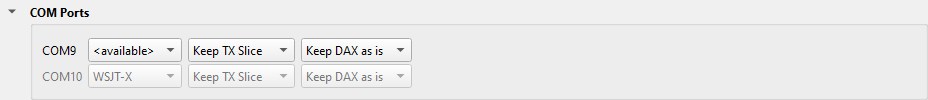
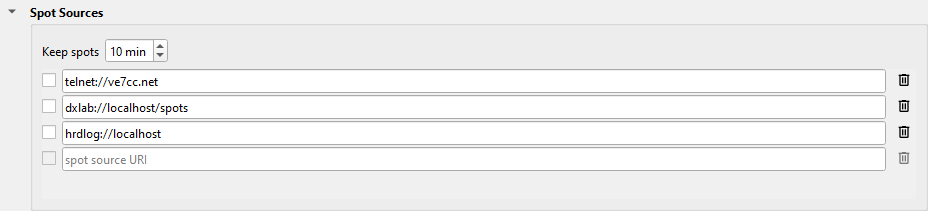

---
title: "N3FJP AC Log"
subtitle: "with Slice Master 6000"
author:
- Donald Beaudry (K1DBO)
- Slice Master 1.0
...

## Introduction

This page tells you how to:

* connect AC Log to the TX slice of your radio, through a COM port.
* send Slice Master's spots to AC Log's DX Spotting window.
* show the spots that AC Log needs, in AC Log's colors.
* log a QSO from a spot in Slice Master.

## Rig Control

AC Log controls the radio only through a COM port.  Slice Master gives it a COM
port that follows the TX slice.

1. Make an **SM6K-** port in SmartSDR CAT for AC Log, as the guide [COM Ports](ComPorts.md)
   tells you.
2. On Slice Master's **...** tab, click **COM Ports** to open the section.

   

3. In the row of that port, select **TX Slice**.  The first column shows the COM
   port that AC Log opens.
4. In AC Log, select **Settings / Rig Interface**.
5. Select the rig **FlexRadio**, and the COM port of step 3.  AC Log's FlexRadio settings are correct for this port.

AC Log now follows the TX slice: its frequency and its mode.

One program at a time can use a COM port.  Give each logger its own SM6K- port.

## Spots to AC Log

Slice Master sends all the spots that it collects on its telnet port: the
spots of the programs that it launches, and of its spot sources.

1. On Slice Master's **...** tab, click **Telnet Aggregation Server** to
   open the section.

   

2. Select **Enable aggregation server**.  Write down the **Telnet port**: 7300
   by default.
3. In AC Log's DX Spotting window, set the telnet connection:
   - host: **127.0.0.1**
   - port: Slice Master's telnet port
   - login: your callsign
   - login command: **SHOW/DX**
4. Select **Auto reconnect**, and connect.

## Spots from AC Log

AC Log sends back each spot that passes its filters, and it marks the spots of a
country that you need.  Slice Master shows the marked spots in the colors that
AC Log uses for a new country.

1. In AC Log, select **Settings / Application Program Interface**.
2. Select **TCP API Enabled (Server)**.  The port is 1100 by default.
3. On Slice Master's **...** tab, click **Spot Sources** to open the
   section.

   

4. In the blank row, type:

   ```
   aclog://localhost
   ```

   - If the AC Log API uses a port that is not 1100, add the port:
     `aclog://localhost:1101`.
   - If AC Log runs on a different computer, type the name or the IP address
     of that computer in place of `localhost`.

5. Select the check box of the row.

The dataset **AC Log** holds these spots.  The view **Needed** shows the spots
that AC Log needs, with the spots of your other loggers.

## Log a QSO from a spot

1. In AC Log, select **Settings / Application Program Interface**.  In **WSJT
   Interface**, select **Listen for WSJT**.
2. Click **Configure**.  Type **127.0.0.1**, and a port that no other program
   uses, for example 2250.
3. In Slice Master's Status Broadcast section, add this row, and select its
   check box:

   ```
   wsjtx-qso://127.0.0.1:2250?label=Log to AC Log
   ```

4. Right-click a spot in Slice Master, and select **Log to AC Log**.  Type a
   comment, and click **Log QSO**.  The QSO shows in AC Log's list of QSOs.

AC Log takes the QSO only as `wsjtx-qso://`, not as `adif-qso://`.

## Support

If AC Log and Slice Master do not work together, send your questions to
the email address on Slice Master's splash screen.
