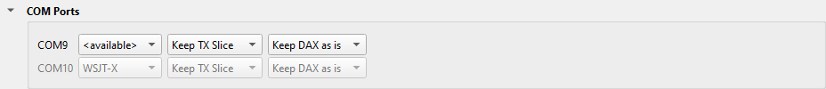

---
title: "COM Ports"
subtitle: "with Slice Master 6000"
author:
- Donald Beaudry (K1DBO)
- Slice Master 1.0
...

## Introduction

Some programs control the radio only through a COM port, for example many
loggers.  Slice Master can give such a program a COM port that follows a slice
of your radio: the TX slice, the active slice, or one slice.

The COM ports come from SmartSDR CAT.  You make them in SmartSDR CAT one time.
Slice Master then lends each one to a program.

This page tells you how to:

* make the ports in SmartSDR CAT.
* give a port to a logger, or to a different program.
* find the cause when a port does not work.

## Port setup

Each port of SmartSDR CAT is a pair of COM ports: one for the program, and one
for Slice Master.  Slice Master uses only the ports whose names start with
**SM6K-**.

1. Close Slice Master and SmartSDR CAT.
2. Start SmartSDR CAT, and add a port:
   - Name: **SM6K-01**.  The name must start with **SM6K-**.
   - Type: **Serial**.
   - Protocol: **CAT**.
3. Add one port for each program that needs one.  Name them **SM6K-02**,
   **SM6K-03** and so on.  Make one more port for each slice if Slice Master
   launches programs that need a port.
4. Write down the COM number of each port.
5. Close SmartSDR CAT.

## Start order

1. Start Slice Master.
2. Start SmartSDR CAT, if you use its other ports.

Slice Master must start before SmartSDR CAT.  If SmartSDR CAT starts first, it
takes the SM6K- ports, and Slice Master cannot use them.

## Port assignment

1. On Slice Master's **...** tab, click **COM Ports** to open the section.

   

   Each row is one SM6K- port.  The first column is the COM port that the
   program opens.

2. Find a row that shows **&lt;available&gt;**.
3. In that row, select the slice that the program follows:
   - **TX Slice**: the slice that transmits.  A logger uses this one.
   - **ACTIVE Slice**: the slice that SmartSDR shows as selected.
   - a slice letter: that slice.
4. If you want, select the TX choice and the DAX choice of the row.  They work
   as for the TCP CAT listeners.
5. In the program, set its radio port to the COM port of the first column.  Set
   the radio type as for a port of SmartSDR CAT.

When the program opens the port, the row turns gray and shows the program's
name.

One program at a time can use a port.  Give each program its own port.

Slice Master gives a port to the programs that it launches, when they need one.

## Port problems

- **The COM Ports section does not show.**  SmartSDR CAT has no port whose name
  starts with **SM6K-**, or the port is not **Serial**.  Make the ports again.
- **The section shows, but the program cannot open its port.**  Look at the
  first column: the program must open that COM port, not the other port of the
  pair.  Make sure that no other program has the port open.
- **The program's port does not follow the slice.**  SmartSDR CAT may have
  started before Slice Master.  Close both, then start Slice Master first.
- **The program opens the port, but nothing happens.**  Some programs do not
  open the port when they start.  Open it in the program's radio settings.

## Support

If a COM port does not work, send your questions to the email address on Slice
Master's splash screen.
