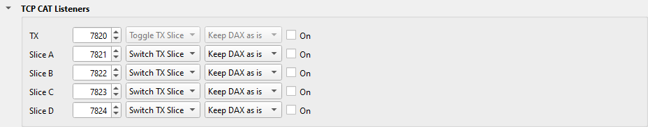
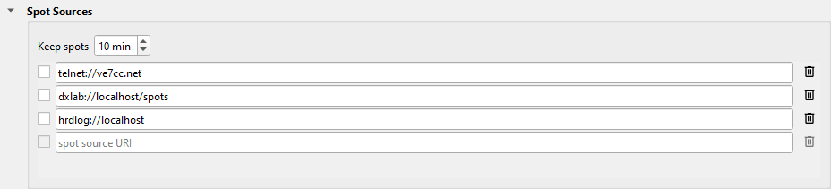

---
title: "DXLab"
subtitle: "with Slice Master 6000"
author:
- Donald Beaudry (K1DBO)
- Slice Master 1.0
...

## Introduction

This page tells you how to:

* connect DXLab Commander to the TX slice of your radio, through Slice Master.
* send Slice Master's spots to DXLab SpotCollector.
* show the spots that SpotCollector says you need, in SpotCollector's colors.

DXKeeper needs no settings for Slice Master.

## Commander

Commander connects to Slice Master's TCP CAT listener as a Thetis radio.

1. On Slice Master's **...** tab, click **TCP CAT Listeners** to open the
   section.

   

2. In the **TX** row, select **On**.  Write down the port: 7820 by default.
3. In Commander's configuration, set the radio model to **Thetis**.
4. Set the address to **127.0.0.1**, and the port to the port of the TX row.

Commander now follows the TX slice: its frequency, its mode and its S-meter.
Commander's Split button works: with split on, the radio receives on VFO A
and transmits on VFO B.

Do not use the model **FlexSig** with Slice Master.  FlexSig connects Commander
to the radio directly, and not to the TX slice.

If you use Commander's UDP Network Service, do not send it to Slice Master's N1MM
Logger+ port.

## Spots to SpotCollector

Slice Master sends all the spots that it collects on its telnet port: the
spots of the programs that it launches, and of its spot sources.

1. On Slice Master's **...** tab, click **Telnet Aggregation Server** to
   open the section.

   

2. Select **Enable aggregation server**.  Write down the **Telnet port**: 7300
   by default.
3. In SpotCollector, set a spot source to the telnet cluster at host
   **127.0.0.1** and Slice Master's telnet port.  Give it a caption, for
   example **SM6K**.

## Spots from SpotCollector

Slice Master reads SpotCollector's spots, with the need of each: unworked,
unworked on this band or mode, unconfirmed, and the others.  It shows them in
the colors that SpotCollector gives them.  There are two ways to read them.
Use the database if you can.

### The database

SpotCollector must run on the same computer as Slice Master.

1. On Slice Master's **...** tab, click **Spot Sources** to open the
   section.

   

2. In the blank row, type:

   ```
   dxldb://localhost/spots
   ```

3. Select the check box of the row.

Slice Master reads each new spot and each spot that comes again.

### The web page

Use the web page if SpotCollector runs on a different computer.  The web page
gives only the 25 newest spots.

1. In SpotCollector's configuration, turn on the Web Server, at port 80.
   To test it, open `http://127.0.0.1/spots` in a browser on that computer.
2. In SpotCollector's Spot Database Display tab, give a different color
   to each need: **unworked** and **unworked band/mode** must not have the same
   color, and **unneeded** and **verified** must not have the same color.
3. In Slice Master's Spot Sources section, find the row
   `dxlab://localhost/spots`.  Type the name or the IP address of the
   SpotCollector computer in place of `localhost`.
4. Select the check box of the row.

The dataset **SpotCollector** holds these spots.  The view **Needed** shows the
spots that SpotCollector says you need, with the spots of your other loggers.

## Support

If DXLab and Slice Master do not work together, send your questions to
the email address on Slice Master's splash screen.
