---
title: "HRD Logbook"
subtitle: "with Slice Master 6000"
author:
- Donald Beaudry (K1DBO)
- Slice Master 1.0
...

## Introduction

This page tells you how to:

* connect HRD Logbook to the TX slice of your radio, through Slice Master.
* get the needed status of each spot from HRD Logbook, to color the spots.
* connect HRD Logbook's DX Cluster pane to Slice Master's telnet port.
* log a QSO from a spot in Slice Master.

## Rig Control

With Slice Master, you do not need HRD Rig Control.  HRD Logbook connects to
Slice Master's HRD listener.

Before you start, make sure that Slice Master is connected to your radio, and
that the radio has a TX slice.

1. On Slice Master's **...** tab, click **HRD Listeners** to open the
   section.

   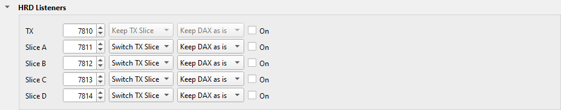

2. In the **TX** row, select **On**.  Write down the port: 7810 by default.

3. In HRD Logbook, click **Options** on the Radio Pane.

   

   The Radio Pane Configuration window opens.

   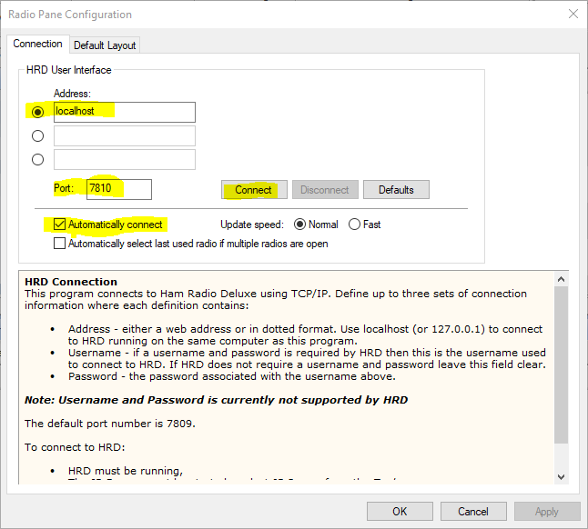

4. In **Address**, type the name or the IP address of the computer where Slice
   Master runs.  On the same computer, type **localhost**.
5. In **Port**, type the port of the TX row.
6. Select **Automatically connect**.
7. Click **Connect** to test the connection, then click **OK**.

HRD Logbook's Radio Pane now shows your radio.

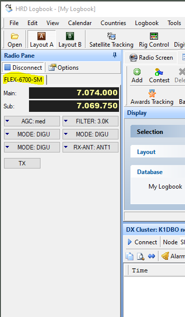

To select the controls that the Radio Pane shows, click **Options** again, and
click the **Default Layout** tab.

To connect HRD Logbook to one slice, and not to the TX slice, use the row of
that slice.

## Needed Status

Slice Master asks HRD Logbook if it needs the station of each spot.  The
dataset **HRD Logbook** colors the spots with the answer: worked on this band
in gray, a new country in green, a new band in red, and the others in blue.
The maps, the lists, the overlays and the radio's panafalls show these
colors.

1. In HRD Logbook, select **Tools / Configure / Network Server**.

   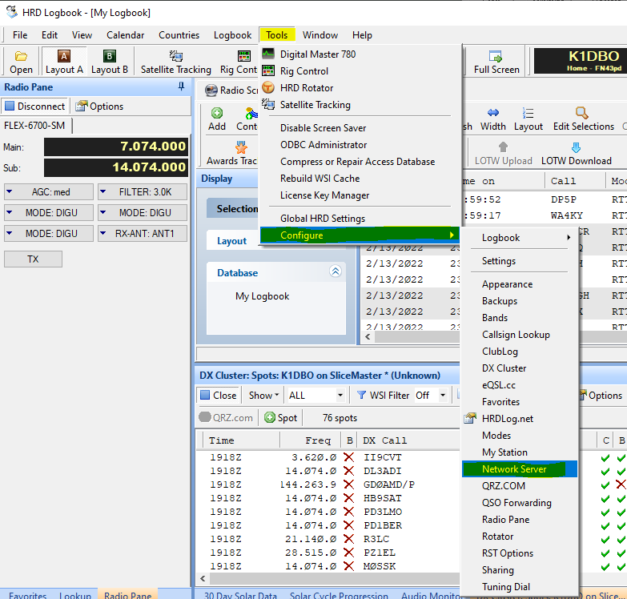

   The Network Server window opens.

   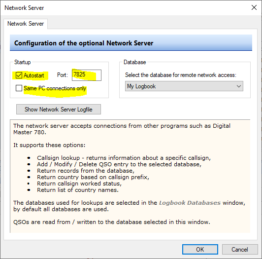

2. Make sure that **Autostart** is selected.  Write down the **Port**: 7825 by default.
   If Slice Master runs on a different computer, clear **Same PC connections
   only**.
3. On Slice Master's **...** tab, click **Spot Sources** to open the
   section.

   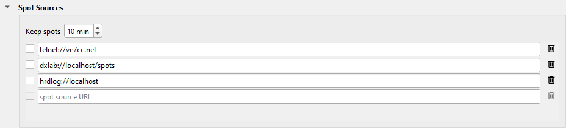

4. Find the row `hrdlog://localhost`.  If there is no such row, type it in the
   blank row.
   - If HRD Logbook uses a port that is not 7825, add the port:
     `hrdlog://localhost:7826`.
   - If HRD Logbook runs on a different computer, type the name or the IP
     address of that computer in place of `localhost`.
5. Select the check box of the row.

## DX Cluster

Slice Master sends all the spots that it collects on its telnet port: the
spots of the programs that it launches, and of its spot sources.  HRD Logbook's
DX Cluster pane can show these spots.

1. On Slice Master's **...** tab, click **Telnet Aggregation Server** to
   open the section.

   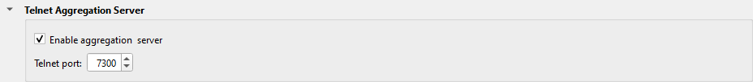

2. Select **Enable aggregation server**.  Write down the **Telnet port**: 7300 at
   first.
3. In HRD Logbook, click **Options** on the DX Cluster pane.

   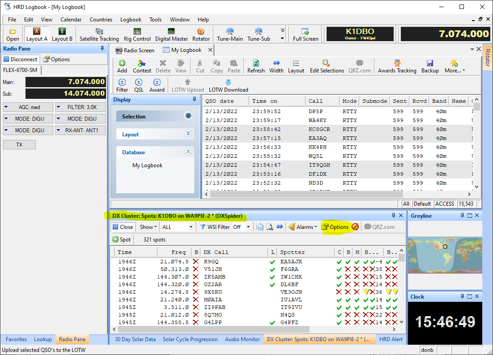

   The DX Cluster Options window opens.

   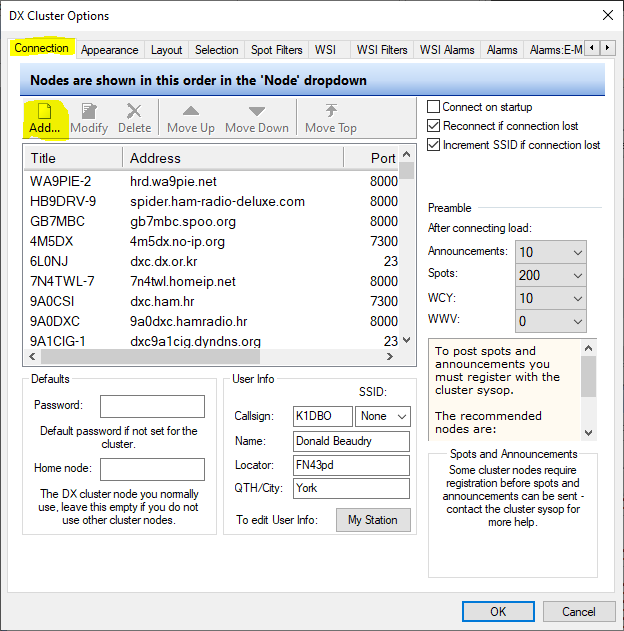

4. Click **Add**.

   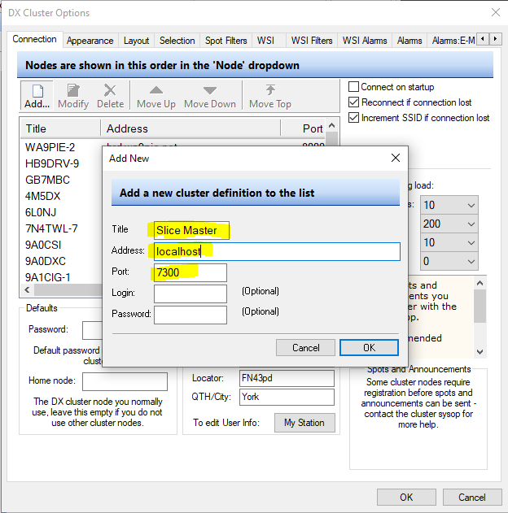

5. In **Title**, type a name, for example **Slice Master**.
6. In **Address**, type the name or the IP address of the computer where Slice
   Master runs.  On the same computer, type **localhost**.
7. In **Port**, type Slice Master's telnet port.
8. Leave **Login** and **Password** empty.
9. Click **OK**, then click **OK** in the DX Cluster Options window.
10. If the DX Cluster pane is connected to a cluster, click **Close**.

    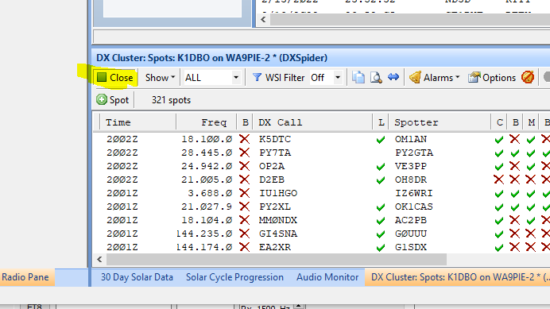

    The list of clusters shows.

    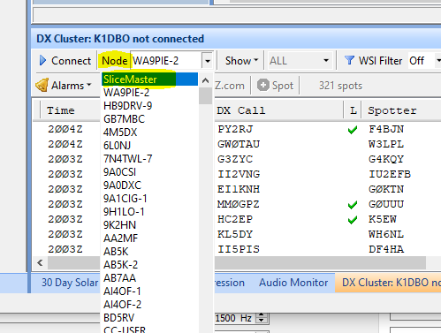

11. Select the cluster that you added, at the top of the list, and click
    **Connect**.

By default, HRD Logbook connects to the WA9PIE cluster.  To see its spots with
Slice Master's spots, add this row in Slice Master's
Spot Sources section, and select its check box:

```
telnet://hrd.wa9pie.net:8000?set/ve7cc;sh/dx/50
```

## Log a QSO from a spot

1. In HRD Logbook, select **Tools / Configure / QSO Forwarding**.
2. In **UDP Receive**, select the receive, and type its port, for example 2333.
   Select all the check boxes.  In **Target Database**, select your log.
3. Click **OK**.
4. In Slice Master's Status Broadcast section, add this row, and select its
   check box:

   ```
   adif-qso://127.0.0.1:2333?label=Log to HRD
   ```

5. Right-click a spot in Slice Master, and select **Log to HRD**.  Type a
   comment, and click **Log QSO**.  The QSO shows in HRD Logbook.

## Support

If HRD Logbook and Slice Master do not work together, send your questions to
the email address on Slice Master's splash screen.
