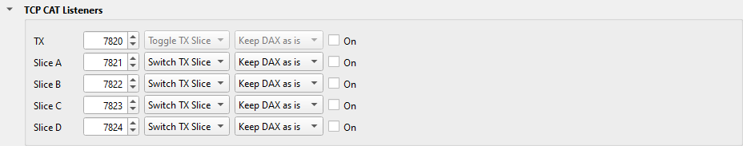
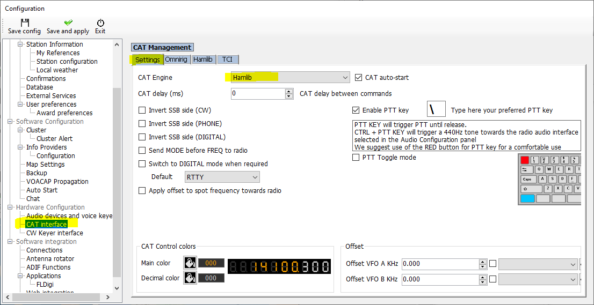
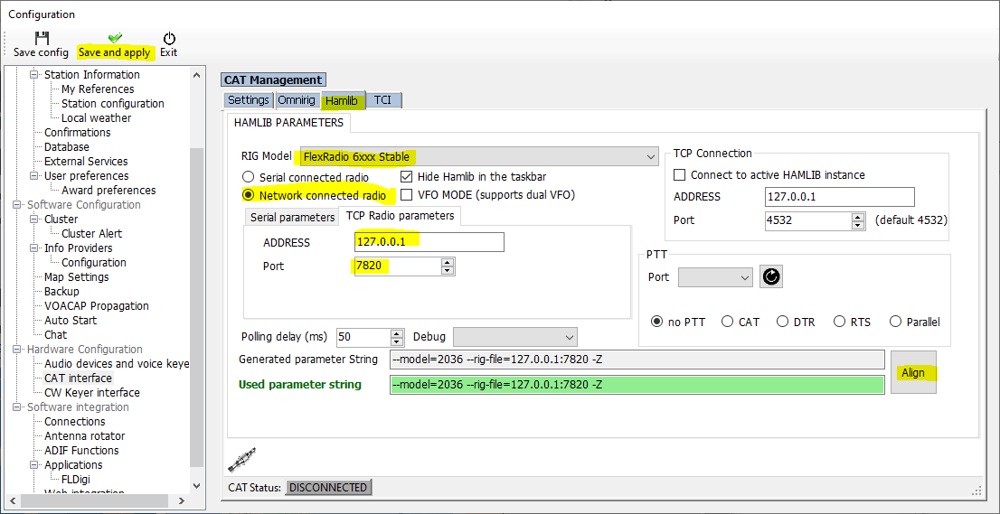

---
title: "Log4OM"
subtitle: "with Slice Master 6000"
author:
- Donald Beaudry (K1DBO)
- Slice Master 1.0
...

## Introduction

This page tells you how to connect Log4OM to the TX slice of your radio,
through Slice Master.  Log4OM then follows the TX slice: the slice that
SmartSDR shows with a red TX.  It also tells you how to log a QSO from a spot
in Slice Master.

## Slice Master

1. On Slice Master's **...** tab, click **TCP CAT Listeners** to open the
   section.

   

2. In the **TX** row, select **On**.  Write down the port: 7820 by default.

## Log4OM

1. In Log4OM, open the Configuration window, and click the **CAT Management**
   tab.

   

2. In **CAT Engine**, select **Hamlib**.  Then click the **Hamlib** tab.

   

3. In **RIG Model**, select **FlexRadio 6XXX**.
4. Select **Network connected radio**.
5. In **TCP Radio parameters**, type **127.0.0.1** in **ADDRESS**, and the port
   of the TX row in **Port**.
6. In **TCP Connection**, leave **Port** at **4532**.  Do not type Slice Master's port there.

   The Parameter String is now:

   ```
   --model=2036 --rig-file=127.0.0.1:7820 -Z
   ```

7. Click **Save and apply**.  The CAT Status light turns green, and the window
   closes.

If Log4OM does not follow the TX slice, look at the Port in **TCP
Connection**.  It must be 4532.  If it is Slice Master's port, Log4OM
connects but does not control the radio.

## Log a QSO from a spot

1. In Log4OM, open the Configuration window, and select **Software
   Integration / Connections**.
2. Add a connection: **UDP_INBOUND**, the service **ADIF_MESSAGE**, a port
   that no other program uses, for example 2236.  Select it.
3. Click **Save and apply**.  Log4OM does not keep the connection if you close
   the window without it.
4. In Slice Master's Status Broadcast section, add this row, and select its
   check box:

   ```
   adif-qso://127.0.0.1:2236?label=Log to Log4OM
   ```

5. Right-click a spot in Slice Master, and select **Log to Log4OM**.  Type a
   comment, and click **Log QSO**.  The QSO shows in Log4OM's Recent QSOs.

## Support

If Log4OM and Slice Master do not work together, send your questions to
the email address on Slice Master's splash screen.
