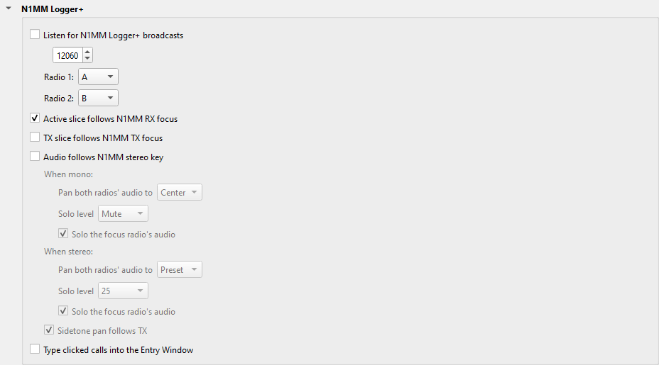
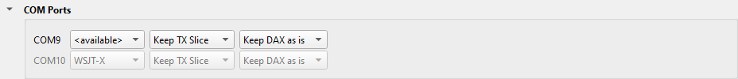

---
title: "Logger32"
subtitle: "with Slice Master 6000"
author:
- Donald Beaudry (K1DBO)
- Slice Master 1.0
...

## Introduction

This page tells you how to:

* send Slice Master's spots to Logger32.
* show the spots that Logger32 sends back, in Logger32's colors.
* connect Logger32 to the TX slice of your radio, through a COM port.
* log a QSO from a spot in Slice Master.

## Spots to Logger32

Slice Master sends all the spots that it collects on its telnet port: the
spots of the programs that it launches, and of its spot sources.

1. On Slice Master's **...** tab, click **Telnet Aggregation Server** to
   open the section.

   

2. Select **Enable aggregation server**.  Write down the **Telnet port**: 7300 at
   first.
3. In Logger32, connect the telnet window or the localhost window to
   **localhost**, at Slice Master's telnet port.

## Spots from Logger32

Logger32 sends its spots as N1MM Logger+ spots, with its own colors, to UDP port
12061 by default.  In Logger32, make sure that DX spots go out as UDP broadcasts.

1. On Slice Master's **...** tab, click **N1MM Logger+** to open the
   section.

   

2. Select **Listen for N1MM Logger+ broadcasts**, and set the port to
   **12061**.

Slice Master listens on one port only.  With the port set to 12061, Slice
Master does not get N1MM Logger+'s spots.

The dataset **N1MM Logger+** holds Logger32's spots, in the colors that
Logger32 gives them: the background tells what you need, for example a new
country or a new band.  To show only the spots that Logger32 sends back, select
the view **N1MM Logger+** in the view box of a map, a list, or the Radio tab.
The view **Needed** shows them too, with the spots of your other loggers.

## Rig Control

Logger32 controls the radio only through a COM port.  Slice Master gives it a
COM port that follows the TX slice.

1. Make an **SM6K-** port in SmartSDR CAT for Logger32, as the guide
   [COM Ports](ComPorts.md) tells you.
2. On Slice Master's **...** tab, click **COM Ports** to open the section.

   

3. In the row of that port, select **TX Slice**.  The first column shows the COM
   port that Logger32 opens.
4. In Logger32, set the radio port to that COM port, as for a port of
   SmartSDR CAT.
5. Make sure that Logger32 opens the port: select **Automatic Open** in its
   radio settings, or open the port yourself.

Logger32 now follows the TX slice.

## Log a QSO from a spot

1. In Logger32, right-click **UDP** in the status bar.
2. Set the WSJT-X UDP port of radio 1 to a port that no other program uses, for
   example 2251.  For a second radio, set its port too, for example 2252.
3. Select **Allow automatic QSO logging**.
4. In Slice Master's Status Broadcast section, add this row, and select its
   check box:

   ```
   wsjtx-qso://127.0.0.1:2251?radio2=2252&label=Log to Logger32
   ```

   With one radio, leave out `radio2=2252&`.  The N1MM Logger+ section of
   Slice Master sets which slice is radio 1 and which is radio 2.

5. Right-click a spot in Slice Master, and select **Log to Logger32**.  Type a
   comment, and click **Log QSO**.  The QSO shows in Logger32's logbook.

Logger32 takes the QSO only as `wsjtx-qso://`, not as `adif-qso://`.  It does
not log a second QSO with the same station on the same band a short time after
the first: it calls that a duplicate.

## Support

If Logger32 and Slice Master do not work together, send your questions to
the email address on Slice Master's splash screen.
