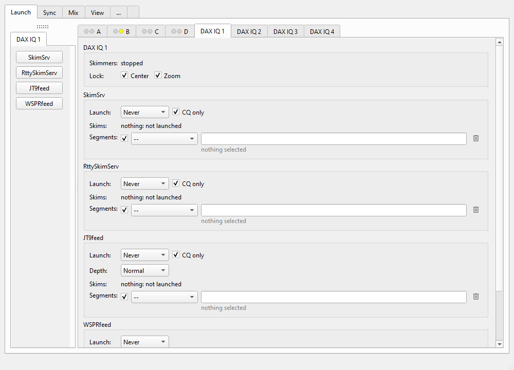
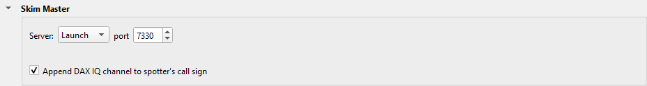

---
title: "Skim Master"
subtitle: "with Slice Master 6000"
author:
- Donald Beaudry (K1DBO)
- Slice Master 1.0
...

Skim Master skims a DAX IQ channel of your radio: it decodes all the signals in
a part of a band, and sends their spots to Slice Master.  It runs four skimmers:

```
SKIMMER          MODES                               SECTION
CW Skimmer       CW                                  SkimSrv
Server
RTTY Skimmer     RTTY                                RttySkimServ
Server
JT9feed          FT8, FT4, FST4, FST4W, Q65          JT9feed
WSPRfeed         WSPR                                WSPRfeed
```

Slice Master starts Skim Master for you.  You set what each DAX IQ channel skims
on the Launch tab, on the tabs **DAX IQ 1** to **DAX IQ 4**.



## Requirements

- **CW Skimmer Server** and **RTTY Skimmer Server**, from Afreet Software,
  for CW and RTTY.  Install them in their default folders: the **Afreet**
  folder in **Program Files** or **Program Files (x86)**.
- **WSJT-X**, for JT9feed and WSPRfeed.  JT9feed and WSPRfeed come with Slice
  Master, and use WSJT-X's decoders.  Install WSJT-X in its default folder:
  **C:\\WSJT\\wsjtx**, or the **wsjtx** folder in **Program Files**.
- **A DAX IQ channel on a panafall.**  In SmartSDR, give the panafall that you
  want to skim a DAX IQ channel.  Skim Master skims only while a panafall has
  that channel.
- **The DAX IQ rate.**  Set the channel's rate in DAX Control Panel.  The
  rate sets how wide a part of the band one channel can skim:

  ```
  DAX IQ RATE    SKIMS AT MOST
  48 kHz         43.2 kHz
  96 kHz         86.4 kHz
  192 kHz        172.8 kHz
  ```

- **Your callsign.**  The skimmers spot as the callsign in Slice Master's
  **Operator** section.  With no callsign there, they use the radio's
  callsign.

A DAX IQ tab shows a section for each skimmer that Skim Master finds on this
computer.  If you installed a skimmer server in a different folder, run Slice
Master's setup again.  On its **Skimmers** page, click **Browse** beside the
skimmer server, and select its .exe file.

## Quick start

**Skim 40 m CW.**

1. In SmartSDR, put a panafall on 40 m, and give it DAX IQ channel 1.
2. On the Launch tab, click **DAX IQ 1**.
3. In the **SkimSrv** section, in the blank row of **Segments**:
   - In the choice box, select the view **Contest Usage**.
   - In the text field, type **40m cw skim**, and push Enter.
4. Under the row, Slice Master shows the parts of 40 m that it will skim.
5. In **Launch**, select **When active**.

The **Skimmers** line shows **skimming** and the part of the band that the
channel skims.

**Skim FT8 on 20 m.**

1. Put a panafall on 20 m, and give it DAX IQ channel 2.
2. Click **DAX IQ 2**.
3. In the **JT9feed** section, in the blank row of **Segments**:
   - Select the view **WSJT-X Usage**.
   - Type **20m ft8**, and push Enter.
4. In **Launch**, select **When active**.

Or, with the view **--**, type the frequencies and the mode yourself:
**14.074-14.077 ft8**.

**When you change a section, select When active again.**  A change to a row, to
CQ only of a skimmer server, to Depth, or to Lock sets **Launch** to **Never**.
Look at the rows, then select **When active**.

The **DAX IQ** quick launch shows a button for each skimmer of the channel.  A
button is green while its skimmer runs.

## Segments

A row of **Segments** says what the skimmer skims.  It has:

- the check box: select it to use the row.  Clear it to keep the row, and skim
  nothing with it.
- the view: the band plans that the row searches.  Select **--** to type the
  frequencies yourself.
- the text field: the words of the search.
- the trash can: remove the row.

Type one or more searches, with a comma between two searches.  Each search can
have these words:

```
WORD                 EXAMPLE         EFFECT
a band               40m             the search stays on that band
a mode               cw  rtty  ft8   the mode to skim: cw, rtty, ft8,
                                     ft4, fst4, fst4w, q65, wspr
a frequency pair     7.000-7.040     a range, in MHz or kHz
                     7000-7040
a word of the plan   skim  dx        the plan's entries that have
                                     that word (with a view only)
```

Examples:

```
VIEW            SECTION       SEARCH                    RESULT
Contest Usage   SkimSrv       40m cw skim               40 m CW skim ranges
Contest Usage   RttySkimServ  20m rtty skim             20 m RTTY skim ranges
WSJT-X Usage    JT9feed       40m ft8, 40m ft4          40 m FT8 and FT4 ranges
--              SkimSrv       7.000-7.040, 7.060-7.070  those two ranges, in CW
--              JT9feed       7074-7077 ft8             that range, in FT8
--              SkimSrv       40m                       all of 40 m, in CW
```

- A section of one mode skims all that its rows find in its mode.
- JT9feed skims several modes, so a range that you type for it must name its
  mode.  Without a mode, the line under the row says **refused: name the
  mode**.
- With a view, the band and the words search the view's plans.  Frequency
  pairs that you type are skimmed too.

Under each row, Slice Master shows each part that the row finds, with its
mode.  A part that the plan gives for a different mode shows both modes: **FT4
as WSPR** is an FT4 range that the WSPR skimmer skims for WSPR.  The color tells
how much of the part Skim Master skims:

- **green**: all of it.
- **yellow**: some of it.  The line shows the parts skimmed.
- **red**: none of it, and the line says **not skimmed**.  The part is not in
  the part of the band that the channel skims now, or the skimmer cannot decode
  more.  Move the panafall, select **Lock / Center**, or ask for less.

While the skimmer runs, each line also shows the spots per hour there: its own,
and from all sources.

## Channel Settings

The top of a DAX IQ tab is for the channel:

- **Skimmers**: what the skimmers do now (see below).
- **Lock / Center**: select it to move the panafall to the middle of the parts
  to skim, and hold it there.  If you move the panafall in the band, it goes
  back.  If you move it to a different band, Skim Master skims that band's parts
  of the rows.
- **Lock / Zoom**: select it to set the panafall's width to the part that the
  channel skims.

Each section has:

- **Launch**: **Never**, or **When active**: while a panafall has this DAX IQ
  channel.
- **CQ only**: select it to get only the spots of stations that call CQ.
  WSPRfeed has no CQ only.
- **Depth** (JT9feed and WSPRfeed): **Fast**, **Normal** or **Deep**.  A deeper
  decode finds more stations, and uses more CPU.
- **Skims**: what the skimmer skims now, and whether it runs.

## Spot display

The spots of Skim Master go everywhere that Slice Master's other spots go: the
maps, the lists, the radio's panafalls, and Slice Master's telnet port.

- The dataset **Skim Master** holds them, with the parts that each channel
  skims.
- The view **Skim Master** shows the DAX IQ channels, what each skims, and the
  spots.  Select it in the view box of a map or a list.
- With **Append DAX IQ channel to spotter's call sign** selected, in the Skim
  Master settings, the spotter of each spot is your callsign and the channel:
  **K1ABC/IQ1**.

## Remote Skim Master



On Slice Master's **...** tab, in the **Skim Master** section:

- **Launch**: Slice Master starts Skim Master on this computer, on the port
  that you set: 7330 by default.  Use this setting if you can.
- **Connect**: Slice Master uses a Skim Master that already runs.  Type its
  HOST:PORT.

The computer where Skim Master runs must have the skimmers, DAX, and the DAX IQ
channels.  Let **skim-master.exe** take connections on its port through the
Windows firewall of that computer.

The section's status line shows if Skim Master runs, and if Slice Master is
connected to it.

## Skimmer status

The **Skimmers** line of a DAX IQ tab:

```
STATUS                                 MEANING
stopped                                no section launches its skimmer.  To
                                       start one, select When active in it.
waiting: no panafall has DAX IQ 1      no panafall has this channel.  Give a
                                       panafall the DAX IQ channel.
paused: the panafall is moving         the channel skims again when the
                                       panafall stops.
skimming 7.000-7.173                   the channel skims this part of the band.
```

The **Skims** line of a section:

```
STATUS                                 MEANING
7.000-7.040 -- running                 the skimmer skims these parts of the
                                       band.
nothing: not launched                  the section does not launch its
                                       skimmer.  To start it, select When
                                       active.
nothing yet                            Skim Master has not started yet.
nothing: none of its segments is in    no segment is in the part of the band
the window                             that the channel skims.  Move the
                                       panafall, or select Lock / Center.
nothing: its window overlaps DAX IQ    RTTY Skimmer Server: two channels skim
1's                                    the same part of the band.  Give each
                                       channel a different part.
nothing: its DAX IQ rate, 96 kHz, is   RTTY Skimmer Server: the channels have
not DAX IQ 1's 192 kHz                 different DAX IQ rates.  Give them the
                                       same rate.
```

One RTTY Skimmer Server serves all the DAX IQ channels.  So the channels that
skim RTTY must have the same DAX IQ rate, and must not skim the same part of a
band.

The status line of the Skim Master section in the settings:

```
STATUS                                 MEANING
running, connected                     Skim Master runs, and Slice Master
                                       gets its spots.
not running, no radio                  Slice Master is not connected to the
                                       radio.  Connect it.
not running, no channel skims          no DAX IQ tab launches a skimmer.
                                       Select When active on a DAX IQ tab.
program not found                      Skim Master is not installed.  Run
                                       Slice Master's setup again.
```

If a section does not show on a DAX IQ tab, Skim Master did not find that
skimmer.  Look at **Requirements**.

## Support

If Skim Master does not work, send your questions to the email address on Slice
Master's splash screen.
