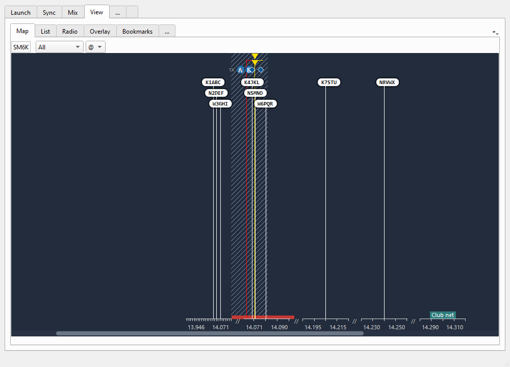
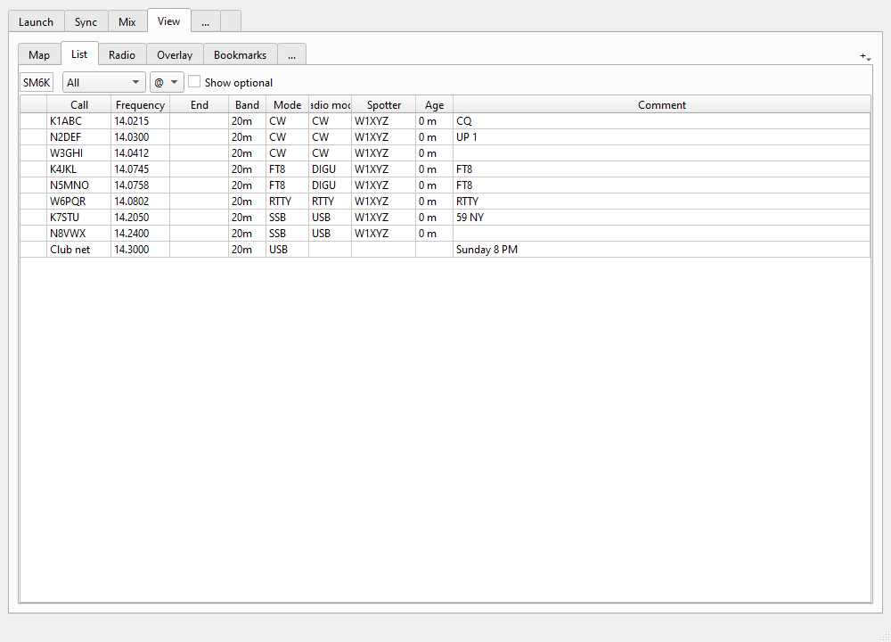
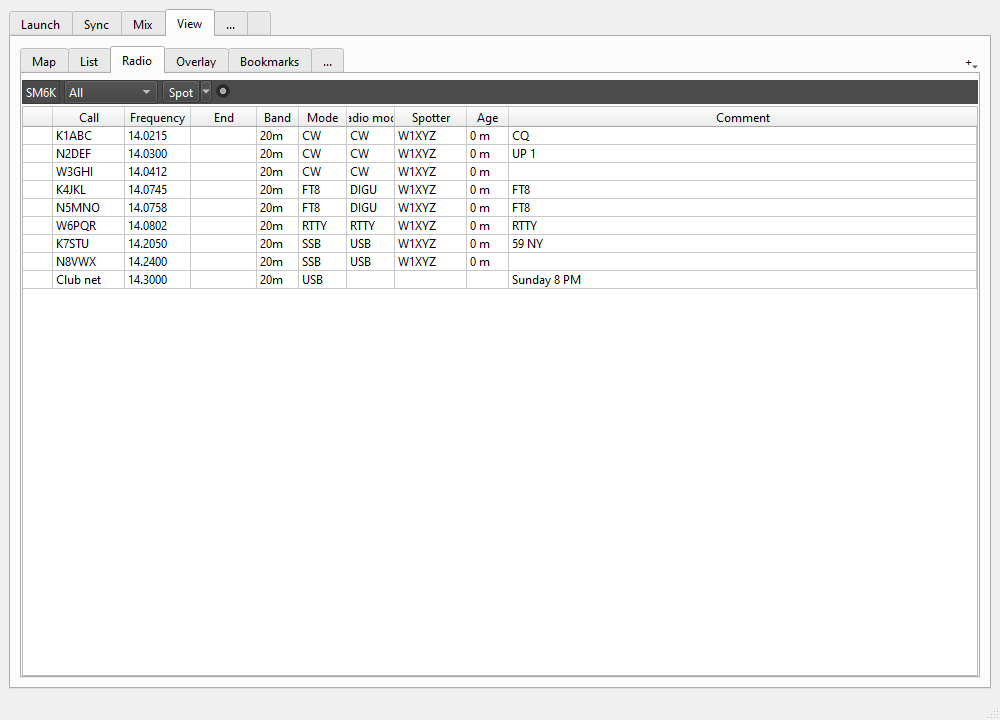
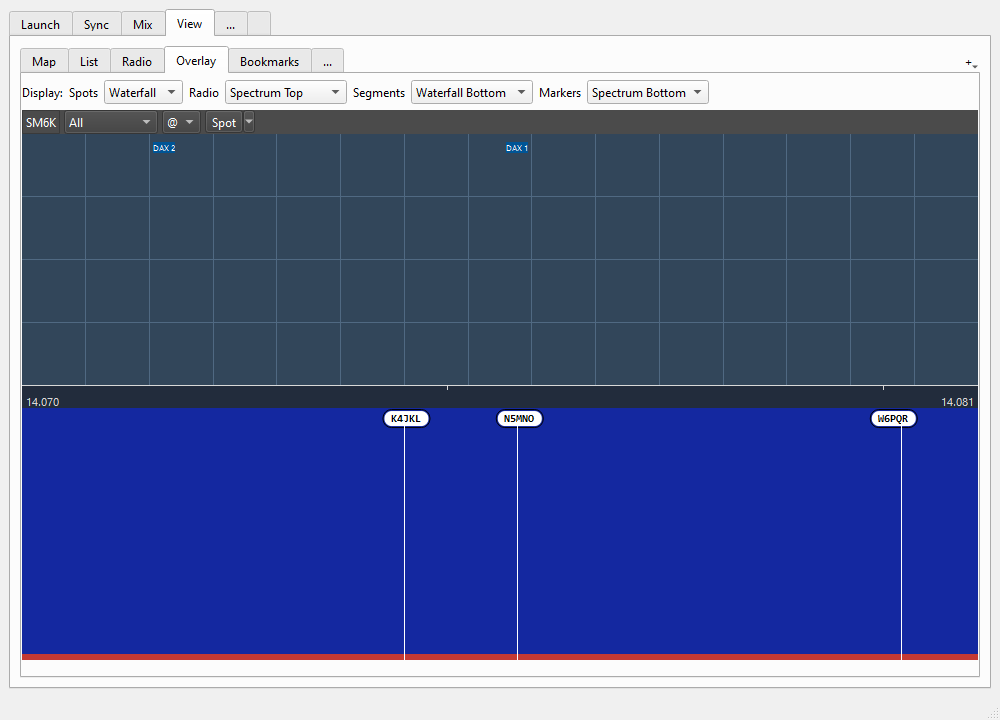
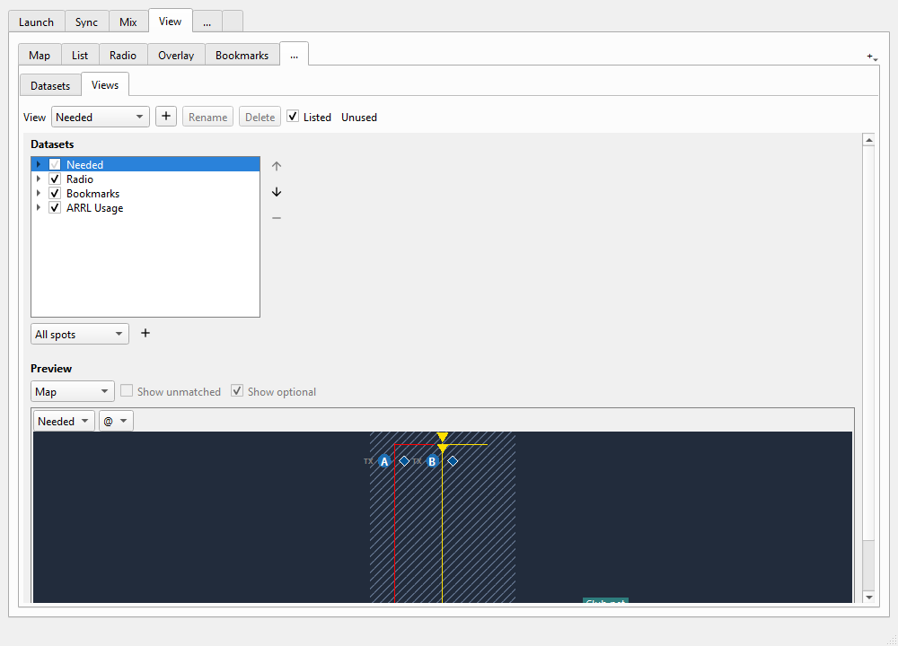
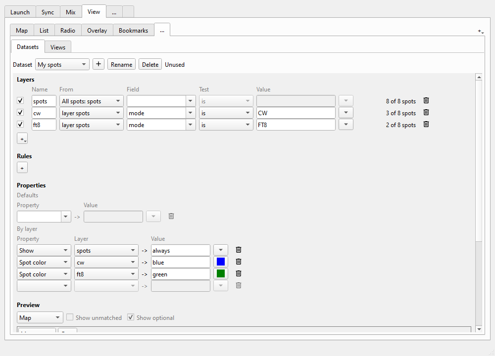
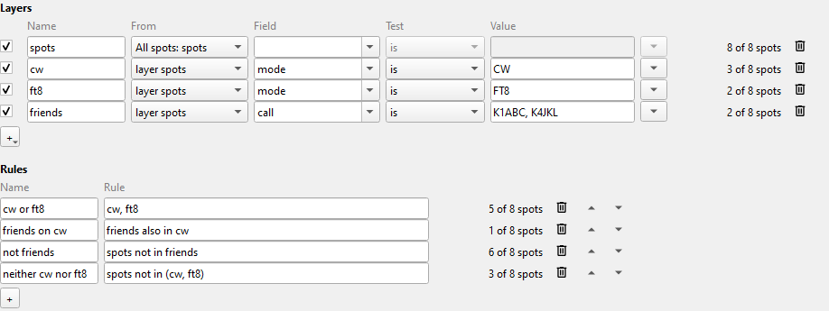
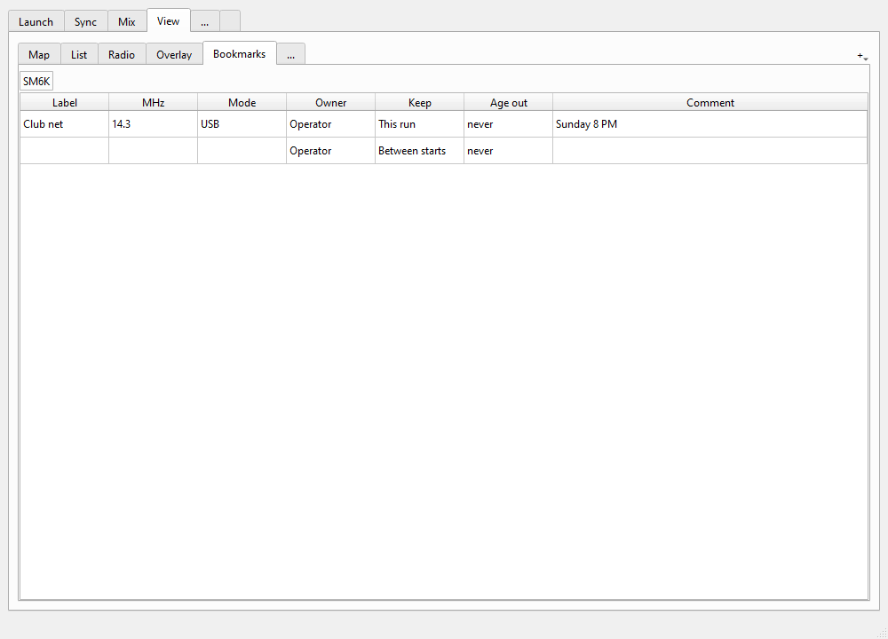
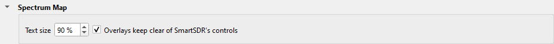

---
title: "Spectrum Maps"
subtitle: "with Slice Master 6000"
author:
- Donald Beaudry (K1DBO)
- Slice Master 1.0
...

The **View** tab shows the spots that Slice Master collects: from DX clusters,
from loggers, from POTA, from the digital mode programs that it launches, and
the spots that you type.  It also shows your slices, your panafalls, their DAX
channels, your bookmarks and the band plans that you select.

This guide tells you how to use the View tab: how to read a map, tune from a
spot, put spots on SmartSDR, and choose what each display shows.

## 1. The View tab



The View tab has these tabs:

- **Map**: the spots on a strip of the band.  See 2.
- **List**: the spots in a table.  See 3.
- **Radio**: the spots that go to the SmartSDR panafalls.  See 4.
- **Overlay**: the maps that Slice Master puts on SmartSDR panafalls.  See 5.
- **Bookmarks**: the frequencies that you keep.  See 10.
- **...**: the **Library**.  It is always the last tab.  Here you change the
  views and the datasets: what each display shows.  See 7 and 8.

Slice Master's settings are on a tab with the same label, **...**, at the
end of the main window.

Each display has the same header:

- the **SM6K** chip: drag it to move the display (see 6).
- the **view box**: the view that the display shows.  By default, Map and List
  show **All**.  Select **--** to show nothing.
- the **target box**: the slice that a click on a spot tunes.  **@** is the
  active slice, **TX** is the TX slice, or select a slice letter.  The Radio tab
  has no target box: it uses the active slice.

To add a map or a list, click **+** at the right end of the tab bar, and select
**New map** or **New list**.  Or drag the **SM6K** chip of the Map or List tab
onto the tab bar.  To close a display, click the close button on its tab.  Drag
the tabs to put them in a different order.

Slice Master keeps your displays, your views and your datasets, and they come back
when Slice Master starts again.

## 2. Maps

A map shows the band as a strip, with the frequency scale along the bottom.

**Read the map.**

- Each spot stands on a stick that points to its frequency.  The best spots are
  at the top.
- Where spots are near each other, the scale opens up, so that you can read each
  callsign.  Where there are no spots, the scale closes up, and `//` shows the
  gap.  Each stretch shows the frequencies of its ends.
- A map with one spot shows the band of that spot, when the view has no panafall
  and no band of its own.
- When a stack of spots is taller than the strip, the lowest spots become a white
  **+N** bubble.  Put the pointer on the bubble to see the callsigns in it.
- A spot from a program that Slice Master launched has round corners.  A spot
  from outside has square corners.
- Each slice shows as SmartSDR shows it: a line at its frequency, yellow for the
  active slice and red for the others, with a bar as wide as its filter.  The disc
  with the slice letter is beside the line, with TX on its left.
- A slice with a DAX channel has a small diamond beside its line.  It is blue when
  no program uses the channel, and green when the channel sends audio.
- A panafall shows as a light hatched area.  A small yellow triangle points to
  its center.  A DAX IQ channel shows as a line in the top row, with its name.
- A band plan shows as colored bars just above the scale.
- A radio memory or a bookmark shows as a tag with its name, just above the
  scale.
- The line under the strip tells what is under the pointer: the frequency, the
  band, the slices, the panafalls, and what each band plan says there.

**Tune from a spot.**

- Put the pointer on a spot to see its note.
- Click a spot to tune the slice of the target box to it.
- Double-click a spot to tune and announce it.  To announce is to send the spot
  to the programs on Slice Master's telnet port, for example your logger.
  A dataset can change what a click and a double-click do (see 8).
- Right-click a spot to select a slice for that one click, or to remove the spot.
- Click a memory tag to activate the memory.  Click a bookmark tag to tune to it.

**Make a spot.**

1. Click the disc of a slice.  A small form opens at the pointer.
2. Type the callsign in **Call** and, if you want, a note in **Note**.
3. Click **Add**, or push Enter.

The spot has the frequency and the mode of the slice, and your callsign as its
spotter.

**Move along the band.**

- Turn the mouse wheel, or push Page Up, Page Down, Home or End.
- Push the letter of a slice (A, B ...) to go to that slice.  Push **@** for
  the active slice, and **T** for the TX slice.
- When a slice is not in view, its disc waits at the edge with an arrow.  Click
  it to go to that slice.

**Move a panafall.**

- Drag in the hatched area of a panafall to move the panafall along the band.
- Click in it to center the panafall there.
- Click the scale to center the strip and the panafall there.  Drag the scale to
  move the strip; the panafall follows.

## 3. Lists



A list is a table of the spots of its view, the best first.  The radio memories,
the bookmarks and the segments of band plans are rows too.  Each callsign has
the colors that it has on a map.

- Put the pointer on a callsign to see its note.
- Double-click a row to tune the slice of the target box to it.  A memory is
  activated.
- Select **Show optional** to also list the items that the view shows only where
  there is space, for example the segments of a band plan.  They are on tinted
  rows.
- Drag a column header to move the column.  Drag its edge to change its width.
- To select the columns, right-click the header.  A window opens.  Select the
  columns that you want, and click **OK**.  You can also select a field of one
  program, for example WSJT-X's SNR.

**Count the spots.**  Rows that are the same in all the columns that show become
one row.  The first column tells how many spots the row has.  For example, hide
Call, Frequency and Age: the list then shows how many spots each band and mode
has.

## 4. Spots on the SmartSDR panafalls



Slice Master sends spots to the radio's panafalls.  The **Radio** tab sets
which spots go, and lists them.

- **The view box**: the radio's view.  By default, it is **All**.  Select
  **--** to send no spots.  If you had "Show internal spots" off in Slice Master
  0.11, it starts as **Needed**.  If you had "Send to radio" off in 0.11, it
  starts as **--**.  The box lists only the views that can send spots to the
  radio.
- **Spot**: make a spot, a bookmark or a memory at the active slice (see 10).
- **The small round button**: click it to take the spots off the panafalls.
  Click it again to put them back.

A click on a Slice Master spot on a SmartSDR panafall tunes the active slice, as
a click on any SmartSDR spot does.  Double-click a row of the Radio tab to tune
the active slice to it.

**Set the view from SmartSDR.**  You can put a small chooser on SmartSDR's title bar:

1. Drag the **SM6K** chip of the Radio tab onto the empty part of SmartSDR's title bar.
2. The **SM6K** chooser stays on the title bar.  It has the view box, **Spot**,
   the round button and an **X**.

To move the chooser, drag its **SM6K** label along the title bar.  Click its
**X** to close it.  The radio keeps its view.

## 5. A map on a SmartSDR panafall



An **overlay** is a map on a SmartSDR panafall, and it draws the spots over their
signals.  The **Overlay** tab shows how an overlay looks, on a sample panafall.

**Make an overlay.**

1. In the view box of the Overlay tab, select the view for the new overlay.
2. Drag the **SM6K** chip of the Overlay tab onto a SmartSDR panafall.  The
   panafall can be in SmartSDR's window or in a window of its own.
3. Drop the chip.  The panafall gets an overlay.
4. Do this for each panafall that you want.

Each overlay has a title bar: its view box, its target box, **Spot**, a button
that hides the spots, and an **X** that closes it.  To move an overlay to a
different panafall, drag its **SM6K** label onto that panafall.

**Set where the overlays draw.**  The **Display** row of the Overlay tab sets this
for all the overlays:

- **Spots**: over the **Waterfall** (by default) or over the **Spectrum**.
- **Radio**: where the DAX IQ channels go.  By default: **Spectrum Top**.
- **Segments**: where the bars of the band plans go.  By default: **Waterfall
  Bottom**.
- **Markers**: where the memories and the bookmarks go.  By default: **Spectrum
  Bottom**.

Each of the last three is **Spectrum Top**, **Spectrum Bottom**, **Waterfall
Top** or **Waterfall Bottom**.  Select **--** to draw nothing.

An overlay does not draw what SmartSDR already shows: the slices, the panafall
and its center.  It does not cover SmartSDR's controls: the side menu, the
slice flags and their panels, and the zoom buttons.  To let it cover them, clear
**Overlays keep clear of SmartSDR's controls** in the settings (see 11).

Your overlays come back when Slice Master starts again.  If you had "Send to
overlay" on in Slice Master 0.11, each panafall gets an overlay of All one time
(of Needed, if you had "Show internal spots" off).

## 6. A display in its own window

**Move a display to a window.**  Drag the **SM6K** chip of the display, and drop
it on the desktop.  The display opens in a window of its own.  From the Map or
List tab you get a copy, and the tab stays.

While you drag, each place that can take the display shows a blue frame.

**Use the window.**

- Drag its title bar to move it.  Drag its edge to change its size.
- Click the **pin** to keep the window above the other windows.
- Click the **gear** to open the view of the display in the Library.
- Click the **x** to close the window and the displays in it.  Their views stay.

**Put two displays in one window.**  Drop a second display on the window.  The
two become tabs.  Drag a chip out of the window to take that display out.

**Put a display back.**  Drag its chip onto the tab bar of the View tab.

Windows come back to the same place when Slice Master starts again.

## 7. Views

A **view** is a list of datasets.  A **dataset** puts spots and other items
into layers, and gives them their colors and other properties.  The view box of
a display selects its view.

**Show a different view.**  Select the view in the view box of the display.

- **All**: all the spots, your slices and panafalls, and your bookmarks.
- **Needed**: the spots that your loggers say you need, with your slices and
  bookmarks.
- Each dataset has a view of its own, with its name.  Select it to show only
  that dataset.

A change to a view changes all the displays that show it: the maps, the lists,
the radio and the overlays.  To change one display only, make a view of your own
for it.

**Make a view of your own.**



1. Click the **...** tab (the Library), then click **Views**.
2. Select a view to start from, for example **All**.
3. Click **+**.  Slice Master makes a copy.  Type its name, and push Enter.
4. Change its datasets:
   - To add a dataset, select it in the box under the list, and click the plus.
     It goes on top.
   - To remove a dataset, select it, and click the minus.
   - To move a dataset, select it, and click the up or down arrow.  The colors
     of the top dataset show over the colors of the datasets below it.
   - To stop using a dataset for a time, clear its check box.
5. Click the arrow beside a dataset to see its layers.  Clear a layer to hide its
   spots in this view only.
6. Select the new view in the view box of a display.

The **Preview** at the bottom shows the view as a map, a list, or both.

On the Views page you can also:

- **Rename** a view: type the new name, and push Enter.
- **Delete** a view.  The displays that show it then show **--**.
- Clear **Listed** to keep a view out of the view boxes.
- See which displays use the view: **Used by**.

**Show only N1MM Logger+'s multipliers.**  On the Views page, open the
layers of the **N1MM Logger+** dataset in your view, and clear `n1mm`, `dupe`,
`new qso` and `bust`.

## 8. Your own datasets



Make a dataset when no view shows what you want.  On the Datasets page, a
dataset has three parts:

- **Layers**: each layer selects a set of spots.
- **Rules**: each rule joins layers into a new set.
- **Properties**: what the spots of each layer get: show or not, colors, score,
  what a click does.

A dataset shows nothing until a **Show** property shows its spots.

**Start a dataset.**

1. Click the **...** tab (the Library), then click **Datasets**.
2. Select **All spots**.  Its layer `spots` holds all the spots.
3. Click **+**.  Slice Master makes a copy.  Type its name, and push Enter.

The copy has the row **Show**, **spots**, **always** under **By layer**: it shows
all the spots.  To show only some spots, delete that row with its trash can.

Each dataset that you make is a file in the `datasets` folder, in Slice Master's data folder.  The guide [Dataset Files](DatasetFiles.md) tells you how to write
the file.

**Add a layer.**

1. Click **+** under the layers, and select **Layer**.
2. In **From**, select the layer to take spots from: a layer of this dataset, or a
   layer of a different dataset, for example **POTA: spots**.
3. In **Field**, select what to test, for example **mode**.
4. In **Test**, select **is**, **is not**, **matches** or **matches regex**.
5. In **Value**, type the value, or click the button beside it to select from the
   values that the spots have now.

Slice Master gives the layer a number: 1, 2, 3.  Type over the number to give it
a name of your own, for example **pota**.  Beside each layer, **Selected** tells
how many spots it has now.  A row with a mistake has a red border, and the
reason shows under it.

**Add a rule.**  Click **+** under the rules.  Type the rule in **Rule**, with the
names of the layers and the rules above it, and push Enter.  Beside each rule,
the count tells how many spots it has now.



The rules above use the layers **spots**, **cw**, **ft8** and **friends**.  They
join the names with these words:

- `,` (either): `cw, ft8` is the CW spots and the FT8 spots.
- `also in` (narrow to): `friends also in cw` is the CW spots of your friends.
- `not in` (leave out): `spots not in friends` is all the spots, but not the
  spots of your friends.
- `( )` (group): `spots not in (cw, ft8)` is the spots that are not CW and not
  FT8.

The words read from left to right: `spots also in cw not in friends` is the CW
spots, but not the spots of your friends.  A list after **also in** or **not in**
is one set: `friends also in cw, ft8` is the CW and FT8 spots of your friends.
A rule can use only the layers and the rules above it.  Click the arrows to move
a rule up or down.

Between spots and other items, "in" means at the same frequency: `spots also in
slicea` is the spots in the passband of slice A.  Put a name with a space in
quotes: `'DX window' not in cw`.

**Add a property.**

- **Defaults**: a property for all the layers.  Select the property, and give its
  value.
- **By layer**: a property for one layer.  Select the property, the layer, and
  the value.  Click the button beside the value to select it, for example a
  color.

Each list of rows ends in an empty row.  Select a property in it to add a row.

**Show the dataset.**  Add it to a view (see 7), or select its own view in the
view box of a display.

### Examples

**Show the POTA spots on CW in yellow.**

1. Start a dataset from **All spots** (see above).  Name it **POTA CW**.
2. Add a layer: From **layer spots**, Field **source**, Test **is**, Value
   **POTA**.  Name it **pota**.
3. Add a layer: From **layer pota**, Field **POTA.mode**, Test **is**, Value
   **CW**.
   Name it **pota cw**.
4. Under **By layer**, add **Spot background**, layer **pota cw**, value
   **yellow**.
5. On the Views page, add **POTA CW** to your view, on top.

The POTA spots on CW now have a yellow background.

**Show only the spots that your logger needs.**  Select the view **Needed** in
the view box.  You do not need a dataset of your own.

**Hide the FT8 spots on the map.**

1. Start a dataset from **All spots**.  Name it **No FT8**.
2. Add a layer: From **layer spots**, Field **mode**, Test **is**, Value
   **FT8**.  Name it **ft8**.
3. Under **By layer**, add **Show**, layer **ft8**, value **never**.
4. Make a view of your own from **All**, and add **No FT8** to it, on top.
5. Select that view in the view box of the map.

The map no longer shows the FT8 spots, but the other displays do not change.

**Show only the CW and RTTY spots that your station hears.**

1. Start a dataset from **All spots**, and delete its row **Show**, **spots**,
   **always**.
2. Add a layer: From **layer spots**, Field **local**, Test **is**, Value
   **true**.  Name it **local**.
3. Add a layer: From **layer local**, Field **mode**, Test **is**, Value **CW
   RTTY**.  Name it **cw rtty**.
4. Under **By layer**, add **Show**, layer **cw rtty**, value **always**.
5. Select the own view of the dataset in the view box of a map.

**Keep the FT8 spots on the map for 5 minutes only.**  In a dataset with a layer
of the FT8 spots, add **Max age**, that layer, value **5**.

**Use a layer in a different dataset.**  Give the layer a name of your own.  It
then shows in the **From** list of the other datasets, under the name of its
dataset.  A layer whose name is a number, or starts with `_`, stays in its own
dataset.

**Rename or delete a dataset.**  Click **Rename** or **Delete** at the top of the
Datasets page.  The datasets that come with Slice Master cannot change: click
**+** to make a copy that you can change.

## 9. Band plans

A band plan shows as colored bars on a map.  Slice Master comes with these
plans:

```
PLAN                   CONTENTS
ARRL Privileges        where each US license class can operate, and with which
                       modes, in the colors of the ARRL band chart
ARRL Usage             the ARRL band plan: calling frequencies, DX windows, RTTY
                       and data, beacons, repeaters, simplex
Contest Usage          where contests are, 160 to 10 m, for your IARU region: the
                       CW, phone, RTTY and digital contest segments, DX windows,
                       beacons, what a skimmer searches, frequencies to keep clear
RTTY Usage             the RTTY segments, and the wider contest segments
WSJT-X Usage           the frequencies of FT8, FT4, WSPR, Q65 and the other
                       WSJT-X modes
Skim Master segments   what Skim Master skims now
```

**Show a plan on a map.**  Add the dataset of the plan to the view of the map
(see 7).  Or select the own view of the plan in the view box.  Put the pointer on
a bar to see what it is.

**Show one license class or one use.**  On the Views page, open the layers of the
plan in your view.  Select the layers that you want, and clear the others.

Your IARU region sets which regional segments show.  It is the region of your
radio, set in SmartSDR's radio setup.

**Make a plan of your own.**  A dataset file with entries is a band plan.  Start
from a copy of a plan that comes with Slice Master.  To use your plan in place of
one that comes with Slice Master, give your file the same name, for example
`wsjtx.yaml`.  Your plan then also shows in Skim Master's search.  The guide
[Dataset Files](DatasetFiles.md) tells you how to write the entries.

## 10. Bookmarks



A **bookmark** is a frequency that you keep, with a label: a net, a calling
frequency, a beacon, your CQ frequency.  It is not a spot: Slice Master does not
send it to the telnet port.

The **Bookmarks** tab lists the bookmarks, one row each: Label, MHz, Mode, Owner,
Keep, Age out and Comment.

- **Add a bookmark**: type a label and a frequency in the empty last row.  It is
  yours (Operator), and kept between starts.
- **Change a cell**: double-click it, or select it and type.  MHz takes 14.230
  or 14230.  Keep is **This run** or **Between starts**.  Age out is minutes from
  now; empty is never.
- **Delete bookmarks**: select their rows, and push Delete.

N1MM Logger+ sets bookmarks too: its CQ frequency on each band, and each
frequency that you mark busy (Alt+M).  A busy mark goes after 10 minutes.  You
can delete these bookmarks, but you cannot change them.

Slice Master keeps your bookmarks in `bookmarks.yaml`, in its settings folder.
You can change the file with a text editor.  Slice Master shows your changes
when you save it:

```
format: sm-bookmarks/1
entries:
  - {at: 14.230, label: SSTV, mode: USB, comment: SSTV calling}
  - {at: 3.950, label: Club net, owner: Operator, mode: LSB, comment: Thursday 8 PM}
  - {at: 7.040, label: QRP, ends: 2026-11-01T00:00:00Z}
```

Each bookmark has a frequency in MHz (`at`) and a `label`.  `owner`, `mode`,
`comment` and `ends` (a UTC time) are optional.

**The Spot button.**  The **Spot** button -- on the Radio and Overlay tabs, on
the chooser, and on an overlay -- opens a small form at the pointer, for the slice
of the target box.  On the Radio tab and the chooser, the form is for the active
slice.  The form's title shows the slice and its frequency.  Click the button's
arrow to select what the form makes:

- **Spot**: type a callsign in **Call** and a note in **Note**.
- **Bookmark**: type a **Label**.  The bookmark has the frequency and mode of the
  slice.
- **Memory**: type a **Name**.  The radio makes a memory from the slice.

Click **Add**, or push Enter, to make it.  Push Esc to close the form.

Below them, the arrow shows the entry of each QSO row that is in use (see
[Status Broadcast](broadcast.md), `wsjtx-qso://` and `adif-qso://`).  Select one
to log a QSO at the slice.

## 11. Settings



The settings of the maps are in the **Spectrum Map** section, on the **...** tab
of the main window:

- **Text size**: the size of the text of the maps, as a percent of Slice Master's text.
- **Overlays keep clear of SmartSDR's controls**: selected by default.  The
  overlays then do not cover the side menu, the slice flags and their panels of
  SmartSDR.

## Reference

### The datasets that come with Slice Master

```
DATASET        CONTENTS
All spots      all the spots (layer spots)
User spots     the spots that you typed, or sent with a dx command
Needed         the spots that your loggers say you need, in their colors
Radio          your slices, panafalls, DAX and DAX IQ channels, memories
Bookmarks      your bookmarks
```

Each program that sends spots has a dataset with its name, and its colors.  It is
in the Library, and its own view is in the view boxes, while the program is set
up.  A program in Spot Sources is set up while its row is selected.  A program that
Slice Master launches is set up while Launch is not Never for one or more slices.  The view All
gets the dataset when the program is set up for the first time.  The dataset Skim Master also has the segments that
Skim Master skims (layer segments); in All, that layer starts cleared.

```
DATASET                    COLORS
WSJT-X, JTDX, MSHV,        black on white; a spot that calls CQ (layer cq) has
JS8Call                    a background: light green for WSJT-X, pink for the
                           others
CW Skimmer, Skim Master    gray on white; cq blue, de dark blue
DX clusters                olive; a station that uses LoTW or eQSL has a
                           background (DXSpider)
HRD Logbook                worked gray, new country green, new band red, other
                           blue
N1MM Logger+               dupe gray, new qso blue, single mult red, mult green,
                           bust black; a CW or RTTY spot stays 10 minutes, a phone
                           spot 30
Logger32, AC Log,          the colors that the program sends
SpotCollector
GRITTY, DX Summit, POTA    black on white
```

### The fields that a layer can test

```
ITEM          FIELDS
spot          call, frequency, band, mode, radio_mode, spotter, comment,
              source (the sources that sent it), local (true while your
              station hears it), time; and the fields of each program, for
              example WSJTX.snr
slice         letter, mode, band, frequency, panafall, antenna, txant, dax,
              tx, active (true or false)
DAX channel   channel, slice, band
panafall      number, slice, band, antenna, daxiq
DAX IQ        channel, panafall, rate
radio memory  name, group, owner, mode, radio_mode, frequency, band, number
bookmark      label, owner, mode, band, frequency, comment
band plan     band, use, classes, and the fields of the plan
```

`mode` is the mode of the spot, and the radio mode that it takes: `mode is DIGU`
is all the sound card modes.  `radio_mode` is only the radio mode.  A radio memory's
mode is a radio mode: a list shows it in the Radio mode column.

### The display properties

```
PROPERTY          VALUES                      EFFECT
Show              always, optional, never     always: the display shows the
                                              spots, and a map opens up for
                                              them; optional: where there is
                                              space; never: not shown
Score             a number                    a higher score goes higher on a
                                              map and first in a list; the
                                              scores of all layers add up
Rank              a number                    puts in order the spots of the
                                              same score; programs give it
Place             top, bottom, own            where a map puts the bars of a
                                              plan, or a DAX IQ channel
Spot color        a color, own                the color of the text
Spot background   a color, own                the color behind the text
Click             Tune only, Tune and         what a double-click does; and on
                  announce; Select, TX, Mode  a click, also select the slice,
                                              make it TX, set its mode
Max age           minutes                     how long the dataset keeps a
                                              spot after its last report
```

When two layers give a spot the same property, the lower layer applies.  When two
datasets of a view give it, the top dataset applies.

### Modes

The **mode** of a spot is the word that its source gave: FT8, PHONE, CW, RTTY,
or a radio mode such as DIGU.  The **radio mode** is the mode that a click sets
on the slice: FT8 and the other sound card modes take DIGU; PHONE and SSB take
LSB below 10 MHz (but not on 60 m) and USB above.  Slice Master knows the radio
mode of each mode.  There is nothing to set.
