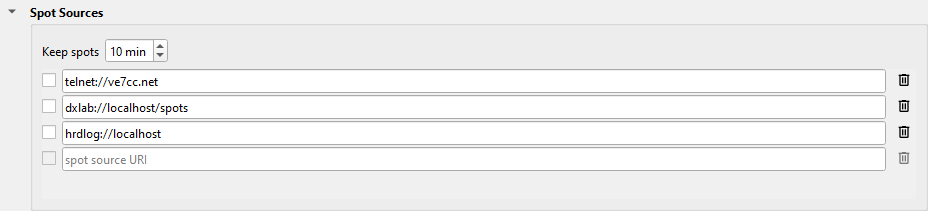

---
title: "Spot Sources"
subtitle: "for Slice Master 6000"
author:
- Donald Beaudry (K1DBO)
- Slice Master 1.0
...

## Introduction

A spot source is a place that sends spots to Slice Master: a DX cluster, a
logger, or a web site.  You set each spot source as a row in the **Spot
Sources** section, on Slice Master's **...** tab.



- Type a URI in the blank row to add a spot source.  You can have ten.
- Select the check box of the row to use the spot source.
- Click the trash can to remove the row.
- **Keep spots** is how many minutes Slice Master keeps a spot after its last
  report.

The programs that Slice Master launches, Skim Master, and N1MM Logger+ send
their spots without a row here.

This page tells you the URI of each type of spot source.  Each type has a
dataset of its own, in the Library, with its colors.

```
URI                           SOURCE
telnet://ve7cc.net            a DX cluster
dxlab://localhost/spots       DXLab SpotCollector, from its web page
dxldb://localhost/spots       DXLab SpotCollector, from its database
hrdlog://localhost            HRD Logbook: the needed status of each spot
aclog://localhost             N3FJP AC Log
dxsmt://www.dxsummit.fi       the DX Summit web site
pota://api.pota.app           the Parks on the Air web site
```

## telnet:// -- a DX cluster

```
telnet://[login[:password]@]host[:port][?commands]
```

- `host` and `port`: the cluster.  By default, the port is 23.
- `login`: by default, your callsign (from the Operator section).
- `password`: only if the cluster asks for one.
- `commands`: the commands to send after the login.  Put `;` between two
  commands.

Examples:

```
telnet://ve7cc.net
telnet://dxc.example.com:7300?set/ve7cc;sh/dx/50
```

`set/ve7cc` asks a CC Cluster for its long spot lines.  `sh/dx/50` asks for the
50 newest spots at the start.

## dxlab:// -- the SpotCollector web page

```
dxlab://host[:port]/spots
```

Reads the spots from SpotCollector's web page.  Use it when SpotCollector
runs on a different computer.

1. In SpotCollector, turn on the Web Server.  By default, its port is 80.
2. Give each need its own color in SpotCollector.

The web page gives the 25 newest spots.  Slice Master reads it every 10
seconds.  The guide [DXLab](DXLab.md) tells you more.

## dxldb:// -- the SpotCollector database

```
dxldb://localhost/spots
```

Reads the spots from SpotCollector's database, with the need of each spot.
SpotCollector must run on the same computer as Slice Master.  Slice Master reads
the new spots and the spots that come again every 5 seconds.

Use this source in place of `dxlab://` when you can.  The guide [DXLab](DXLab.md) tells
you more.

## hrdlog:// -- HRD Logbook

```
hrdlog://[login@]host[:port]
```

Asks HRD Logbook if it needs the station of each spot: worked on this band, a
new country, a new band, or other.  The dataset **HRD Logbook** colors the
spots with the answer.

- HRD Logbook must have its Network Server on.  By default, the port is 7825.

The guide [HRD Logbook](HRDLogbook.md) tells you more.

## aclog:// -- N3FJP AC Log

```
aclog://host[:port]
```

Reads the spots that AC Log sends back, each with AC Log's mark when you
need its country.  Slice Master shows the marked spots in the colors that AC Log
uses for a new country.

- AC Log must have its TCP API on.  By default, the port is 1100.

The guide [N3FJP AC Log](ACLog.md) tells you more.

## dxsmt:// -- DX Summit

```
dxsmt://www.dxsummit.fi[?filters]
```

Reads the newest spots from the DX Summit web site every 15 seconds.  With no
filters, it reads the 50 newest spots of all bands.

The filters select the spots.  There are two ways to set them:

- Set the filters on the DX Summit web site.  The site puts them in the address
  bar of your browser.  Copy the address into the row, and change `https://` to
  `dxsmt://`:

  ```
  dxsmt://www.dxsummit.fi/#/?include=HF&include_modes=CW
  ```

- Type the filters after `?`.  Put `&` between two filters, and a comma between
  two values:

  ```
  dxsmt://www.dxsummit.fi?include=14MHz,21MHz&dx_continents=AF,SA
  ```

DX Summit does not document its filters.  These are the filters that its web
site uses:

```
FILTER            VALUES                                  EXAMPLE
include           bands: HF, LF, VHF, UHF, SHF, WARC,     include=HF
                  1.8MHz, 3.5MHz, 5MHz, 7MHz, 10MHz,
                  14MHz, 18MHz, 21MHz, 24MHz, 28MHz,
                  50MHz, 70MHz, 144MHz, 430MHz ...
exclude           bands, as for include                   exclude=WARC
include_modes     PHONE, CW, DIGI                         include_modes=CW
exclude_modes     PHONE, CW, DIGI                         exclude_modes=DIGI
dx_continents     AF, AN, AS, EU, NA, OC, SA              dx_continents=AF
dx_countries      country names, as DX Summit writes      dx_countries=Italy
                  them
dx_cqzones        CQ zones                                dx_cqzones=14
dx_ituzones       ITU zones                               dx_ituzones=27
dx_prefixes       prefixes                                dx_prefixes=VP8
dx_calls          callsigns                               dx_calls=K1ABC
de_...            the same six filters, for the spotter:  de_continents=NA
                  de_continents, de_countries ...
exclude_dx_...    leave out the spots that the filter     exclude_dx_continents=EU
exclude_de_...    selects
limit             how many spots, by default 50           limit=100
```

DX Summit decides the band, the mode, the continent and the zones of each spot.

## pota:// -- Parks on the Air

```
pota://api.pota.app
```

Reads the spots of the activators from the POTA web site every 60 seconds.
The comment of each spot gives the park: its reference, its location and its
name.

## Support

If a spot source does not work, send your questions to the email address on Slice Master's splash screen.
