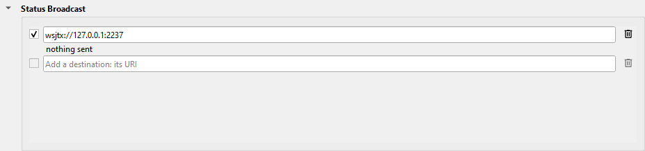

---
title: "Status Broadcast"
subtitle: "with Slice Master 6000"
author:
- Donald Beaudry (K1DBO)
- Slice Master 1.0
...

## Introduction

Slice Master sends the status of your radio to amplifiers, tuners, loggers and
other programs, and sends to loggers the QSOs that you log from a spot.  You set each destination as a row in the **Status Broadcast**
section, on Slice Master's **...** tab.



- Type a URI in the blank row to add a destination.
- Select the check box of the row to send to the destination.
- Under the URI, the row shows what the destination said last.

This page tells you the URI of each type of destination, and what Slice Master
does with it.

## The URI

```
<type>://<login>:<password>@<host>:<port>?<conditions>
```

The type sets the format of the messages, and the program that gets them.  Most
destinations need only the host and the port.

The conditions select the slice that the messages are about.  Put `&` between
two conditions.  The slice must agree with each condition.  A condition can have
more than one value, with a comma between them; the slice must agree with one of
the values.

```
CONDITION   VALUES                                   SLICE
state       tx, active, any                          the TX slice, the active
                                                     slice, or each slice
slice       A to H                                   that slice
tx_ant      ANT1, ANT2, XVTR                         on that TX antenna
rx_ant      ANT1, ANT2, RX_A, RX_B, XVTR             on that RX antenna
band        160m, 80m, 40m, 30m, 20m, 17m, 15m,      on that band
            12m, 10m, 6m, 2m
```

## hfauto:// -- the HF-Auto tuner

```
hfauto://<host>:12020?tx_ant=ANT2&listen=127.0.0.1:13080&key_line=<cable>.<bit>&tune=<seconds>
```

For the HF-Auto tuner, through the **HF-Auto App** from W1TR Software.  The
HF-Auto App's port is 12020 by default.  The login and the password are not
used.

```
KEY        VALUE
tx_ant     the radio's antenna port that the HF-Auto is on.
listen     the address and port where the HF-Auto App sends its status.
           By default: 127.0.0.1:13080.
key_line   the USB cable (its serial number) and the bit of the relay that
           opens the key line of the amplifier after the HF-Auto.
tune       the seconds to wait for the tuner to start a tune after you
           click TUNE in SmartSDR.
```

What Slice Master does:

- It sends the frequency of the TX slice to the HF-Auto every 10 seconds, and
  each time the frequency changes.  The HF-Auto is then usually tuned before you
  transmit.
- While the tuner tunes, Slice Master holds a transmit.
- With `key_line`, Slice Master opens the key line of the amplifier when the SWR
  is high, while the tuner tunes, and while a TUNE from SmartSDR is on.  It
  closes the key line again when the tuner stops.

When you click TUNE in SmartSDR:

1. If the tuner is in manual, Slice Master puts it in automatic.
2. The tuner tunes.
3. The tune ends when the tuner has not changed for `tune` seconds, high SWR or
   not, or when the tuner says that it is done or that it cannot tune.
4. If the tuner was in manual, Slice Master puts it back in manual.

A tune that is still on after 60 seconds is stopped.

To make the tuner tune only when you click TUNE, put it in manual.  To let the
tuner tune when it finds a high SWR, put it in automatic.

While the radio has a Tuner Genius XL, a TUNE is for the Tuner Genius XL.  Slice
Master then does none of the steps above.

## kat500:// -- the Elecraft KAT500 tuner

```
kat500://<login>:<password>@<host>:<port>?tx_ant=ANT2
```

For the Elecraft KAT500 tuner, through the program **KAT500 Remote** from
Elecraft.  The KAT500 Utility is a different program; it does not work.

- KAT500 Remote must run.  The port, the login and the password must be the
  same as in KAT500 Remote.
- Set `tx_ant` to the radio's antenna port that the KAT500 is on.
- `key_line` and `tune` are as for `hfauto://`.

KAT500 Remote does not take the band or the frequency.  A TUNE from SmartSDR
works as for the HF-Auto.  A tune that is still on after 20 seconds is stopped.

## kpa500:// -- the Elecraft KPA500 amplifier

```
kpa500://<login>:<password>@<host>:<port>?tx_ant=ANT2
```

For the Elecraft KPA500 amplifier, through the program **KPA500 Remote** from
Elecraft.  The KPA500 Utility is a different program; it does not work.

- KPA500 Remote must run.  The port, the login and the password must be the
  same as in KPA500 Remote.
- Set `tx_ant` to the radio's antenna port that the KPA500 is on.  When a
  slice transmits on that port, the KPA500 goes to the band of that slice.

Do not use `auto_standby`.  Use SmartSDR's TX profiles in its place.

## radioinfo:// -- RadioInfo packets

```
radioinfo://127.0.0.1:12061?state=any&radio_nr=1&station=STATION
```

Sends the slice in the **RadioInfo** UDP packets of N1MM Logger+, every 8
seconds and each time the slice changes.  Many loggers and programs read these
packets.  By default, `state` is `any`.

```
KEY        VALUE
radio_nr   the radio number of the slice.  By default, the place of the slice
           letter: A is 1.
station    the station name.  By default, the radio client's name.
opcall     the call of the operator.  By default, the station callsign.
```

- Do not use the port that Slice Master's N1MM Logger+ section listens on.
- Each packet tells the radio number of the TX slice and of the active slice.
  Slice Master sends nothing until both slices have a radio number.  With
  `state=any`, each slice has one.

## meter:// -- the radio's meters

```
meter://127.0.0.1:7373?state=active&meters=SLC.LEVEL,TX-.SWR&format=jsonl&rate=250
```

Sends the radio's meters as UDP packets, to a program of your own.  The
conditions select the slice.  By default, `state` is `active`.

```
KEY       VALUE
meters    the meters to send:
            SLC.LEVEL     the signal level of the slice
            SLC.B.LEVEL   the signal level of slice B
            TX-.SWR       a meter of the radio: SOURCE.NAME
            RAD.PATEMP    a meter of the radio
            all           all the meters
          By default: SLC.LEVEL.
format    csv: the values in the order of meters; an old value is empty.
          jsonl: one JSON object on each line.
rate      the milliseconds between two packets.  By default: 100.
```

With no `meters` and no `format`, each packet is the slice, its signal level and
its frequency: `A:-87.5,14.074`.

### The jsonl line

```
{"slice":"A","frequency":14.074,"time":1760467200.25,"state":["ACTIVE"],"rx_ant":"ANT1",
 "SLC":{"LEVEL":-87.5},"TX-":{"SWR":1.5,"tx_ant":"ANT2"},
 "units":{"SLC":{"LEVEL":"dBm"},"TX-":{"SWR":"SWR"}}}
```

- The top of the line tells the slice: its letter, its frequency, the time,
  `state` (`TX`, `ACTIVE`, or both), and its value for each condition of the
  URI.
- Each meter is under its source.  A meter that depends on an antenna has
  that antenna beside its value: a meter of the slice depends on `rx_ant`; a
  meter of the transmitter or the amplifier depends on `tx_ant`.
- A value is `null` while its meter is old.
- `units` gives the unit of each meter, in the same places as the values.

### More than one destination on one port

More than one `meter://` row can send to one port.  A program on that port
selects the lines that it wants with the same URI, written for the address and
port that it listens on.  It takes a line when each condition agrees with the
line (`*` agrees with each value), and the line has each meter that it names:

```
meter://127.0.0.1:7373?rx_ant=ANT1&meters=SLC.LEVEL    the signal level on ANT1
meter://127.0.0.1:7373?state=tx&meters=TX-.SWR         the SWR while you transmit
```

## wsjtx:// -- decodes for programs that listen for WSJT-X

```
wsjtx://127.0.0.1:2237?slice=A,DAXIQ1&band=20m,40m&mode=FT8,FT4
```

Sends the FT8, FT4, FST4, Q65 and JT65 decodes as WSJT-X's UDP messages, to
a program that listens for WSJT-X: for example GridTracker, JTAlert, or a
logger.  The decodes come from the WSJT-X, JTDX and MSHV that Slice Master
launches, and from Skim Master's JT9feed.

```
KEY          VALUE
host:port    the UDP server of the program: a host name, an IPv4 or [IPv6]
             address, or a multicast group.  By default, the port is 2237.
slice        A to H, and DAXIQ1 to DAXIQ4.  By default: all.
band         the bands to send.  By default: all.
mode         the modes to send.  By default: all.
interfaces   for a multicast group only: the network interfaces, by the
             names that WSJT-X uses.  By default: the loopback interface.
ttl          for a multicast group only: the time to live.  By default: 1.
```

- Each decode goes, as WSJT-X sends it.  The spot settings of a program, and
  CQ only of JT9feed, change only Slice Master's spots.
- The program shows each slice, frequency and mode as one WSJT-X, for example
  "SM6K DAXIQ1 FT8 14.074".  One that has no decodes for 5 minutes goes away.
- A click on these decodes in the program does nothing.
- The row shows two rates, in decodes per hour: for the last 10 minutes, and
  for the last hour.  A rate of 0 shows that the decodes stopped.  If the URI
  has a word that Slice Master cannot use, the row says so, and sends nothing.

When Slice Master finds a program that makes these decodes, it adds the row
`wsjtx://127.0.0.1:2237` one time.  If you delete the row, Slice Master does not
add it again.

## wsjtx-qso:// and adif-qso:// -- log a QSO from a spot

```
adif-qso://127.0.0.1:2333?label=Log to HRD
wsjtx-qso://127.0.0.1:2239?radio2=2240&label=Log to N1MM
```

Sends a QSO to a logger, as WSJT-X sends a QSO when you log it.  Each row adds
an entry, with its label, to the menu of a spot on a spectrum map and in a list,
and to the arrow of each **Spot** button.

1. Right-click the spot of the station that you worked, and select the entry.
   Or click the arrow of a **Spot** button, and select the entry: the QSO is
   at the slice of the Spot button.
2. The form shows the callsign, the frequency, the mode and the time (UTC).
   From a Spot button, the callsign is the one of the spot nearest the
   slice's frequency, inside the slice's filter; with no spot there, type the
   callsign.  The frequency and the mode are the slice's.
3. Change the callsign if necessary.  **Sent** and **Received** start at 599
   for CW and RTTY, and at 59 for phone.  Change them if necessary, and type a
   comment.  For a spot that you added, the comment starts as the note of your
   spot.
4. Click **Log QSO**, or push Enter.  Push Esc to close the form and log
   nothing.

```
KEY          VALUE
type         wsjtx-qso: the two messages that WSJT-X's UDP server sends for a
             QSO.  adif-qso: the QSO as ADIF text, as WSJT-X's "N1MM Logger+
             Broadcasts" sends it.  Use the type that your logger reads.
host:port    the UDP port of the logger: a host name, an IPv4 or [IPv6] address,
             or a multicast group.  By default, the port is 2237 for wsjtx-qso
             and 2333 for adif-qso.
label        the text of the menu entry.  By default: Log QSO.
radio2       the UDP port of N1MM Logger+ radio 2.  A QSO on the slice of radio
             2 in the N1MM Logger+ section goes to this port.  Each other QSO
             goes to host:port.
id           the name of the sender that the logger sees.  By default: SM6K.
interfaces   for a multicast group only, as for wsjtx://.
ttl          for a multicast group only, as for wsjtx://.
```

- Slice Master keeps each QSO that it sends in an ADIF file, one file each
  month, in this folder:

  ```
  C:\Users\<your user name>\AppData\Local\K1DBO\slice-master-data\qsos
  ```

  Above each QSO, a line tells when it was sent and to which row.  A logger
  that imports ADIF files can import the file.
- From a spot's menu, the QSO is on the TX slice at the time of the right-click.
- The spot sources of the spot add what they know to the QSO.  For example, a
  spot from the POTA spot source gives its park.  If you change the callsign,
  they add nothing.
- The row shows the last QSO sent, for example "K1XYZ 20m CW sent 23:05".  If
  no program listens on that port of this computer, the row also says "no
  listener".  The logger does not reply: look in the logger for the QSO.
- An entry sends the QSO through its own row only.

The row for each logger:

```
LOGGER         ROW
HRD Logbook    adif-qso://127.0.0.1:2333?label=Log to HRD
AC Log         wsjtx-qso://127.0.0.1:2250?label=Log to AC Log
Logger32       wsjtx-qso://127.0.0.1:2251?radio2=2252&label=Log to Logger32
Log4OM         adif-qso://127.0.0.1:2236?label=Log to Log4OM
N1MM Logger+   wsjtx-qso://127.0.0.1:2239?radio2=2240&label=Log to N1MM
GridTracker    wsjtx-qso://127.0.0.1:2237?label=Log to GridTracker
```

The guides [HRD Logbook](HRDLogbook.md), [AC Log](ACLog.md),
[Logger32](Logger32.md) and [Log4OM](Log4OM.md) tell you how to set up those
loggers.

### N1MM Logger+

1. In N1MM Logger+, select **Config / Configure Ports, Mode Control, Winkey,
   etc**, and click the **WSJT/JTDX Setup** tab.
2. Select the UDP reader of radio 1, and type its port, for example 2239.  For
   SO2R or SO2V, select the reader of radio 2 too, and type its port, for
   example 2240.
3. Click **OK**, and start N1MM Logger+ again.  N1MM Logger+ opens these ports
   only when it starts.
4. In Slice Master's Status Broadcast section, add the row with the two
   ports, and select its check box.

N1MM Logger+ logs the QSO in the log that is open.

### GridTracker

GridTracker reads the port that WSJT-X sends to: 2237 by default.  Add the row
with that port.  GridTracker logs the QSO, and sends it to the loggers that its
Logging settings select.

## Support

If a destination does not work, send your questions to the email address on Slice Master's splash screen.
